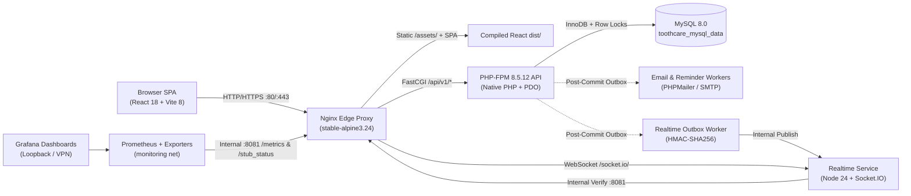

<div align="center">


### Dental Appointment & Clinic Management System

*Healthier Smiles. Brighter Futures.*

<p>
  
  
  
  
  
  
  
  
</p>

[Overview](#overview) •
[Roles](#target-users--roles) •
[Architecture](#system-architecture) •
[Tech Stack](#technology-stack) •
[Quick Start](#quick-start) •
[Local URLs](#local-urls--port-policy) •
[Testing](#testing--verification) •
[Docs](#documentation-index)

</div>

---

## Overview

<p align="justify">
ToothCare Hub is a full-stack, responsive dental appointment and clinic management platform engineered to replace manual scheduling with a transaction-safe digital workflow. <strong>MySQL 8.0 (<code>InnoDB</code>) and a native PHP 8.5 REST API (<code>/api/v1</code>) serve as the authoritative system of record</strong>, paired with a <strong>React 18 + Vite 8</strong> single-page application, <strong>PHPMailer</strong> transactional email outbox workers, a <strong>Node.js + Socket.IO</strong> real-time notification engine, <strong>Docker Compose + Nginx</strong> multi-stage containerization, and <strong>Prometheus + Grafana</strong> operational observability.
</p>

### Core Engineering Objectives

<div align="justify">

1. **Prevent Conflicting Bookings:** Enforce clinic hours, closures, dentist schedules, time-off blocks, and variable service durations using server-side validation and transaction-safe InnoDB row locking (`SELECT ... FOR UPDATE`).
2. **Enforce Least-Privilege Role Boundaries:** Re-validate cookie sessions, CSRF tokens, Dynamic RBAC (DRBAC) permissions, and strict resource ownership on every `/api/v1/*` request.
3. **Isolate Notification Side Effects:** Persist in-app notifications, `email_outbox`, and `realtime_outbox` records inside the booking transaction; deliver SMTP emails and Socket.IO broadcasts post-commit so external outages never roll back a saved appointment.
4. **Deliver Production-Ready Packaging & Visibility:** Run hardened multi-stage containers behind an Nginx edge proxy, gate every change with a 6-job GitHub Actions CI pipeline (including Trivy `v0.36.0` image scans and `promtool` validation), and monitor health via Prometheus and Grafana.

</div>

---

## Target Users & Roles

<div align="justify">

- **Administrator (`ADMIN`):** Manages user accounts, DRBAC role-permission matrices, clinic operating hours/closures, dental services, dentist rosters, and clinic-wide appointments; reviews executive KPIs, operational reports (appointments, service utilization, dentist workload, patient registrations), append-only audit logs, outbox delivery health, and redacted operational errors.
- **Receptionist / Front Desk (`RECEPTIONIST`):** Manages daily arrival schedules, patient check-ins, live waiting queues, walk-in intake/booking, and appointment triage (`CONFIRMED` / `REJECTED`) with role-scoped front-desk KPIs.
- **Dentist (`DENTIST`):** Views strictly scoped daily and upcoming assigned appointments; accesses permitted patient visit context; records versioned clinical treatment notes with FDI tooth charting; marks eligible visits `COMPLETED`; submits time-off requests.
- **Patient (`PATIENT`):** Registers or signs in with email verification; browses active dental services and dentists; checks real-time slot availability; books appointments via a guided wizard; tracks status lifecycle (`PENDING`, `CONFIRMED`, `REJECTED`, `CANCELLED`, `COMPLETED`), receives live Socket.IO + email notifications, and cancels/reschedules within clinic policy rules.

</div>

---

## System Architecture



---

## Technology Stack

<table>
  <thead>
    <tr>
      <th align="center">Layer</th>
      <th align="center">Technology</th>
      <th align="center">Highlights</th>
    </tr>
  </thead>
  <tbody>
    <tr>
      <td align="center"><strong>Frontend</strong></td>
      <td align="justify">React 18, Vite 8 (Rolldown), Tailwind CSS 3, Lucide React, React Router 7, Socket.IO Client</td>
      <td align="justify">Light/Dark theme system, <code>React.lazy</code> code splitting (<code>300.98 kB</code> / <code>65.22 kB</code> gzip main chunk), role portals, search, reports, live notifications</td>
    </tr>
    <tr>
      <td align="center"><strong>Backend API</strong></td>
      <td align="justify">Native PHP (<code>^8.5</code>, <code>8.5.12-fpm-alpine3.24</code>), Composer, PDO, <code>zircote/swagger-php</code></td>
      <td align="justify"><strong>105</strong> OpenAPI 3.0.3 paths (<strong>138</strong> operations) generated from PHP 8 attributes (<a href="docs/openapi.yaml"><code>docs/openapi.yaml</code></a>), dev-only Swagger UI (<code>/api/v1/docs</code>)</td>
    </tr>
    <tr>
      <td align="center"><strong>Database</strong></td>
      <td align="justify">MySQL 8.0 (<code>InnoDB</code>, <code>utf8mb4</code>)</td>
      <td align="justify">32 ordered SQL migrations (<code>001</code>–<code>032</code>), row-level locking, AES-256-GCM encrypted backups, composite reporting/search indexes</td>
    </tr>
    <tr>
      <td align="center"><strong>Email Worker</strong></td>
      <td align="justify">PHPMailer (<code>^7.2</code>) + transactional <code>email_outbox</code></td>
      <td align="justify">Outbox worker (<code>backend/bin/email-worker.php</code>) &amp; reminder scheduler with encrypted payloads, retry policy, and Prometheus age/backlog metrics</td>
    </tr>
    <tr>
      <td align="center"><strong>Real-Time</strong></td>
      <td align="justify">Node.js (<code>24-alpine</code>), TypeScript, Socket.IO (<code>^4.8.1</code>)</td>
      <td align="justify">Short-lived hashed tickets, HMAC-SHA256 internal verification/revocation, non-root <code>read_only</code> runtime</td>
    </tr>
    <tr>
      <td align="center"><strong>Reverse Proxy</strong></td>
      <td align="justify">Nginx (<code>stable-alpine3.24</code>)</td>
      <td align="justify">Hardened <a href="docker/nginx/production.conf"><code>production.conf</code></a> &amp; TLS/WSS template, immutable <code>/assets/</code> cache, privacy-safe <code>$uri</code> access logs, internal port <code>8081</code></td>
    </tr>
    <tr>
      <td align="center"><strong>Containers</strong></td>
      <td align="justify">Docker Compose v2 (<code>compose.yaml</code>, <code>compose.dev.yaml</code>, <code>compose.prod.yaml</code>)</td>
      <td align="justify">Multi-stage builds with <code>apk upgrade --no-cache</code>, zero host source mounts or public MySQL in prod, <code>no-new-privileges</code>, <code>cap_drop: [ALL]</code>, resource limits</td>
    </tr>
    <tr>
      <td align="center"><strong>Observability</strong></td>
      <td align="justify">Prometheus, Grafana, <code>mysqld-exporter</code>, <code>nginx-exporter</code>, <code>cadvisor</code>, <code>node-exporter</code></td>
      <td align="justify"><code>--profile monitoring</code>, 15 alert rules, provisioned Application &amp; Infrastructure dashboards, least-privilege MySQL exporter</td>
    </tr>
    <tr>
      <td align="center"><strong>Quality &amp; CI</strong></td>
      <td align="justify">PHPUnit, Vitest 5, Node <code>node:test</code>, Playwright, Trivy <code>v0.36.0</code>, <code>promtool</code>, CodeQL</td>
      <td align="justify">6-job GitHub Actions CI + Dependabot targeting <code>development</code></td>
    </tr>
  </tbody>
</table>

---

## Repository Structure

```text
ToothCare-Hub/
├── frontend/        # React 18 + Vite 8 SPA (landing, auth, role portals, booking wizard)
├── backend/         # Native PHP 8.5 REST API (/api/v1), OpenAPI attributes, workers, PHPUnit
├── realtime/        # Node.js 24 + TypeScript + Socket.IO real-time notification service
├── database/        # 32 ordered MySQL 8 migrations, rollbacks, synthetic seeds, backup scripts
├── docker/          # Multi-stage Dockerfiles (php/, nginx/) & production Nginx/TLS configs
├── nginx/           # Base nginx.conf, dev vhost, FastCGI & security-header snippets
├── monitoring/      # Prometheus scrape/alert rules, Grafana provisioning/dashboards, exporter SQL
├── deployment/      # Apache fallback example & deployment templates
├── scripts/         # Windows PowerShell helper scripts (setup, testing, OpenAPI generation)
├── docs/            # Complete architecture, API, security, observability & release docs
└── .github/         # GitHub Actions CI workflows, CodeQL, Dependabot
```

---

## Quick Start

### 1. Prerequisites
- **Git** `2.40+` · **Docker Engine / Docker Desktop** with **Compose v2**
- **Direct Host CLI (optional):** PHP `8.5+` (`pdo`, `pdo_mysql`, `openssl`, `mbstring`, `json`, `curl`, `fileinfo`), Composer `2.x`, Node.js `24 LTS`, npm `10+`

### 2. Configure Environment Templates
All `.env.example` files contain safe placeholders only. Copy them locally before starting services *(never commit real `.env` files or place secrets in `frontend/.env`)*:

```powershell
Copy-Item .env.example .env
Copy-Item backend/.env.example backend/.env
Copy-Item frontend/.env.example frontend/.env
Copy-Item realtime/.env.example realtime/.env
```

### 3. Start the Stack (Docker Compose v2)

```powershell
# Start full local development stack (Nginx, PHP-FPM, MySQL 8, Realtime, Workers)
docker compose -f compose.yaml -f compose.dev.yaml up -d --build

# Optional: enable Prometheus, Grafana, Nginx/MySQL exporters, and cAdvisor
docker compose --profile monitoring -f compose.yaml -f compose.dev.yaml up -d

# Stop stack cleanly (preserves persistent toothcare_mysql_data volume)
docker compose -f compose.yaml -f compose.dev.yaml down
```

<details>
<summary><strong>More Docker &amp; Production Compose Commands</strong></summary>

```powershell
# Validate development and hardened production Compose configurations
docker compose -f compose.yaml -f compose.dev.yaml config -q
docker compose -f compose.yaml -f compose.prod.yaml config -q

# Inspect container status and tail logs
docker compose ps
docker compose logs -f nginx php-fpm realtime email-worker mysql

# Validate Nginx syntax inside the running container
docker compose exec nginx nginx -t

# Rebuild a single service without stopping others
docker compose build php-fpm
docker compose up -d --no-deps php-fpm
```

</details>

---

## Local URLs & Port Policy

| Service | Local URL / Port | Exposure Policy | Purpose |
|---|---|---|---|
| **Web App & Portals** | `http://localhost:8080/` | Public edge | ToothCare Hub React SPA |
| **Nginx / API Health** | `http://localhost:8080/health` · `/api/v1/health` | Public edge | Liveness & DB readiness checks |
| **Swagger UI** | `http://localhost:8080/api/v1/docs` · `/api-docs` | Dev/Testing only (`404` in prod) | Interactive OpenAPI 3.0.3 reference |
| **Socket.IO** | `http://localhost:8080/socket.io/` | Proxied WebSocket | Real-time notification transport |
| **Metrics & Stub Status** | `http://nginx:8081/api/v1/metrics` · `/stub_status` | **Internal network only (`403` publicly)** | Prometheus scrape targets |
| **MySQL 8.0** | `127.0.0.1:3306` (`compose.dev.yaml` only) | Private (unpublished in prod) | Authoritative database |
| **Mailpit UI** | `http://127.0.0.1:8025` (`--profile mail`) | Loopback only | Local captured SMTP test emails |
| **Prometheus / Grafana** | `http://127.0.0.1:9090` · `http://127.0.0.1:3001` | Loopback only (`--profile monitoring`) | Metrics, alerts & dashboards |

---

## Testing & Verification

<details open>
<summary><strong>Run Automated Test, Audit &amp; Contract Suites</strong></summary>

```powershell
# Backend PHPUnit (unit + integration) & Composer audit
composer --working-dir=backend validate --strict
composer --working-dir=backend audit --no-interaction
composer --working-dir=backend test:unit
composer --working-dir=backend test:integration

# OpenAPI 3.0.3 generation, drift check, and 100% route-coverage validation
composer --working-dir=backend openapi:generate
composer --working-dir=backend openapi:check
composer --working-dir=backend openapi:validate

# Frontend audit, Vitest component suite, and Vite production build
npm --prefix frontend audit
npm --prefix frontend test -- --run
npm --prefix frontend run build

# Realtime Socket.IO audit, typecheck, build, and tests
npm --prefix realtime audit
npm --prefix realtime run typecheck
npm --prefix realtime test

# Playwright browser E2E tests (local Chromium on dedicated port 5174)
npm run test:e2e:local
```

</details>

---

## Git Branch & Commit Conventions

- **Branches:** `main` (stable/releasable), `development` / `develop` (active integration; Dependabot targets `development`), `feature/<short-description>`, `fix/<short-description>`, `docs/<short-description>`, `chore/<short-description>`.
- **Commits:** Imperative [Conventional Commits](https://www.conventionalcommits.org/) under 72 characters (e.g., `feat(appointments): validate slot conflicts`, `security(docker): upgrade Nginx base to stable-alpine3.24`).

---

## Documentation Index

| Topic | Documentation |
|---|---|
| **Master Index & Setup (Phases 0–2)** | [`docs/README.md`](docs/README.md) · [`local-development.md`](docs/setup/local-development.md) · [`environment-configuration.md`](docs/setup/environment-configuration.md) |
| **Architecture & Security** | [`directory-structure.md`](docs/architecture/directory-structure.md) · [`security-checklist.md`](docs/security/security-checklist.md) |
| **Phase 13 — Email Notifications** | [`email-architecture.md`](docs/modules/email-notifications/email-architecture.md) |
| **Phase 14 — Real-Time Socket.IO** | [`docs/phase-14/architecture.md`](docs/phase-14/architecture.md) |
| **Phase 15 — Dashboards & Reports** | [`docs/phase-15/dashboard-metrics.md`](docs/phase-15/dashboard-metrics.md) |
| **Phase 16 — Testing & Regression** | [`docs/phase-16/testing-strategy.md`](docs/phase-16/testing-strategy.md) |
| **Phase 17 — API Docs & OpenAPI 3.0.3** | [`docs/api/README.md`](docs/api/README.md) · [`docs/openapi.yaml`](docs/openapi.yaml) |
| **Phase 18 — Security, Privacy & Performance** | [`security-audit.md`](docs/phase-18/security-audit.md) · [`production-readiness-checklist.md`](docs/phase-18/production-readiness-checklist.md) |
| **Phase 19 — Prometheus & Grafana** | [`monitoring-architecture.md`](docs/phase-19/monitoring-architecture.md) · [`observability-runbook.md`](docs/phase-19/observability-runbook.md) |
| **Phase 20 — Production Containers & Nginx** | [`production-container-architecture.md`](docs/phase-20/production-container-architecture.md) · [`rollback-procedure.md`](docs/phase-20/rollback-procedure.md) |

---

<div align="center">
  <sub>Distributed under the <a href="LICENSE">MIT License</a> · ToothCare Hub</sub>
</div>
