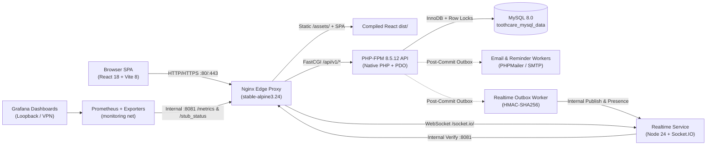

<div align="center">


### Dental Appointment & Clinic Management System

*Healthier Smiles. Brighter Futures.*

<p>
  
  
  
  
  
  
  
  
</p>

[Overview](#overview) •
[Roles](#target-users--roles) •
[Architecture](#system-architecture) •
[Tech Stack](#technology-stack) •
[Structure](#repository-structure) •
[Git Conventions](#git-branch--commit-conventions)

</div>

---

## Overview

<p align="justify">
ToothCare Hub is a full-stack, responsive dental appointment and clinic management platform engineered to replace manual scheduling with a transaction-safe digital workflow. <strong>MySQL 8.0 (<code>InnoDB</code>) and a native PHP 8.5 REST API (<code>/api/v1</code>) serve as the authoritative system of record</strong>, paired with a <strong>React 18 + Vite 8</strong> single-page application featuring Light/Dark semantic theming, a <strong>Node.js + Socket.IO</strong> real-time engine powering live notifications and private <strong>Patient–Dentist Messenger-style chat</strong>, <strong>PHPMailer</strong> transactional email outbox workers, centralized <strong>History Records</strong> and <strong>Archive Management</strong>, <strong>Docker Compose + Nginx</strong> multi-stage containerization, and <strong>Prometheus + Grafana</strong> operational observability.
</p>

### Core Engineering Objectives

<div align="justify">

1. **Prevent Conflicting Bookings:** Enforce clinic hours, closures, dentist schedules, time-off blocks, and variable service durations using server-side validation and transaction-safe InnoDB row locking (`SELECT ... FOR UPDATE`).
2. **Enforce Least-Privilege Role Boundaries & Privacy:** Re-validate cookie sessions, CSRF tokens, Dynamic RBAC (DRBAC) permissions, and strict resource ownership on every `/api/v1/*` request—including participant-only isolation for Patient–Dentist direct messaging.
3. **Isolate Real-Time & Email Side Effects:** Persist in-app notifications, `email_outbox`, and `realtime_outbox` records inside database transactions; deliver SMTP emails and privacy-safe Socket.IO events post-commit so external outages never roll back committed operations.
4. **Preserve Historical Integrity & Compliance:** Maintain append-only Audit Trails, chronological History Records timelines (`Asia/Manila`), and tamper-evident SHA-256 Archive Management with controlled multi-cycle restoration rather than permanent deletion.
5. **Deliver Production-Ready Packaging & Visibility:** Run hardened multi-stage containers behind an Nginx edge proxy, gate every change with a 6-job GitHub Actions CI pipeline (including Trivy `v0.36.0` image scans and `promtool` validation), and monitor health via Prometheus and Grafana.

</div>

---

## Target Users & Roles

<div align="justify">

- **Administrator (`ADMIN`):** Manages user accounts, DRBAC role-permission matrices, clinic operating hours/closures, dental services, dentist rosters, legal document versions, and clinic-wide appointments; reviews executive KPIs, operational reports (appointments, service utilization, dentist workload, patient registrations), append-only Audit Trail logs, centralized History Records, the Archive Management Vault (with multi-cycle restoration), outbox delivery health, and redacted operational errors.
- **Receptionist / Front Desk (`RECEPTIONIST`):** Manages daily arrival schedules, patient check-ins, live waiting queues, walk-in intake/booking, appointment triage (`CONFIRMED` / `REJECTED`), and role-scoped operational History Records and Archive Vault views.
- **Dentist (`DENTIST`):** Views strictly scoped daily and upcoming assigned appointments; communicates securely with patients via real-time Messenger-style direct chat (with typing indicators, delivery/read receipts, online presence, and appointment context); records versioned clinical treatment notes with FDI tooth charting; marks eligible visits `COMPLETED`; reviews clinical archives; and submits time-off requests.
- **Patient (`PATIENT`):** Registers or signs in with email verification and legal consent tracking; browses active dental services, dentists, and the public Help Center; checks real-time slot availability and books appointments via a guided wizard; tracks status lifecycle (`PENDING`, `CONFIRMED`, `REJECTED`, `CANCELLED`, `COMPLETED`), receives live Socket.IO + email notifications, chats directly with clinic dentists, views personal visit and clinical archives, and cancels/reschedules within clinic policy rules.

</div>

---

## System Architecture



---

## Technology Stack

<table>
  <thead>
    <tr>
      <th align="center">Layer</th>
      <th align="center">Technology</th>
      <th align="center">Highlights</th>
    </tr>
  </thead>
  <tbody>
    <tr>
      <td align="center"><strong>Frontend</strong></td>
      <td align="justify">React 18, Vite 8 (Rolldown), Tailwind CSS 3, Lucide React, React Router 7, Socket.IO Client</td>
      <td align="justify">Responsive Light/Dark semantic theme system, <code>React.lazy</code> code splitting (<code>321.37 kB</code> / <code>70.38 kB</code> gzip main chunk), role portals, Messenger-style Patient–Dentist chat, server-side data tables, History Records, Archive Vault, Help Center, and live notifications</td>
    </tr>
    <tr>
      <td align="center"><strong>Backend API</strong></td>
      <td align="justify">Native PHP (<code>^8.5</code>, <code>8.5.12-fpm-alpine3.24</code>), Composer, PDO, <code>zircote/swagger-php</code></td>
      <td align="justify"><strong>141</strong> OpenAPI 3.0.3 paths (<strong>179</strong> operations, <strong>15</strong> schemas) generated from PHP 8 attributes (<a href="docs/openapi.yaml"><code>docs/openapi.yaml</code></a>), dev-only Swagger UI (<code>/api/v1/docs</code>)</td>
    </tr>
    <tr>
      <td align="center"><strong>Database</strong></td>
      <td align="justify">MySQL 8.0 (<code>InnoDB</code>, <code>utf8mb4</code>)</td>
      <td align="justify"><strong>38</strong> ordered SQL migrations (<code>001</code>–<code>038</code>), row-level locking, AES-256-GCM encrypted backups, SHA-256 archive snapshots, cursor-indexed messaging, and composite reporting/history indexes</td>
    </tr>
    <tr>
      <td align="center"><strong>Email Worker</strong></td>
      <td align="justify">PHPMailer (<code>^7.2</code>) + transactional <code>email_outbox</code></td>
      <td align="justify">Outbox worker (<code>backend/bin/email-worker.php</code>) &amp; reminder scheduler with encrypted payloads, retry policy, and Prometheus age/backlog metrics</td>
    </tr>
    <tr>
      <td align="center"><strong>Real-Time</strong></td>
      <td align="justify">Node.js (<code>24-alpine</code>), TypeScript, Socket.IO (<code>^4.8.1</code>)</td>
      <td align="justify">Short-lived hashed tickets, HMAC-SHA256 internal publishing/revocation/presence, privacy-safe non-PII notification &amp; messaging signals, non-root <code>read_only</code> runtime</td>
    </tr>
    <tr>
      <td align="center"><strong>Reverse Proxy</strong></td>
      <td align="justify">Nginx (<code>stable-alpine3.24</code>)</td>
      <td align="justify">Hardened <a href="docker/nginx/production.conf"><code>production.conf</code></a> &amp; TLS/WSS template, immutable <code>/assets/</code> cache, privacy-safe <code>$uri</code> access logs, internal port <code>8081</code></td>
    </tr>
    <tr>
      <td align="center"><strong>Containers</strong></td>
      <td align="justify">Docker Compose v2 (<code>compose.yaml</code>, <code>compose.dev.yaml</code>, <code>compose.prod.yaml</code>)</td>
      <td align="justify">Multi-stage builds with <code>apk upgrade --no-cache</code>, zero host source mounts or public MySQL in prod, <code>no-new-privileges</code>, <code>cap_drop: [ALL]</code>, resource limits</td>
    </tr>
    <tr>
      <td align="center"><strong>Observability</strong></td>
      <td align="justify">Prometheus, Grafana, <code>mysqld-exporter</code>, <code>nginx-exporter</code>, <code>cadvisor</code>, <code>node-exporter</code></td>
      <td align="justify"><code>--profile monitoring</code>, 15 alert rules, provisioned Application &amp; Infrastructure dashboards, least-privilege MySQL exporter</td>
    </tr>
    <tr>
      <td align="center"><strong>Quality &amp; CI</strong></td>
      <td align="justify">PHPUnit, Vitest 5, Node <code>node:test</code>, Playwright, Trivy <code>v0.36.0</code>, <code>promtool</code>, CodeQL</td>
      <td align="justify">6-job GitHub Actions CI + Dependabot targeting <code>development</code></td>
    </tr>
  </tbody>
</table>

---

## Repository Structure

```text
ToothCare-Hub/
├── frontend/        # React 18 + Vite 8 SPA (landing, auth, role portals, messaging, archives, history)
├── backend/         # Native PHP 8.5 REST API (/api/v1), OpenAPI attributes, workers, PHPUnit
├── realtime/        # Node.js 24 + TypeScript + Socket.IO real-time notifications, chat & presence service
├── database/        # 38 ordered MySQL 8 migrations, rollbacks, synthetic seeds, backup scripts
├── docker/          # Multi-stage Dockerfiles (php/, nginx/) & production Nginx/TLS configs
├── nginx/           # Base nginx.conf, dev vhost, FastCGI & security-header snippets
├── monitoring/      # Prometheus scrape/alert rules, Grafana provisioning/dashboards, exporter SQL
├── deployment/      # Apache fallback example & deployment templates
├── scripts/         # Windows PowerShell helper scripts (setup, testing, OpenAPI generation)
├── docs/            # Architecture, API, security, observability, and release documentation
└── .github/         # GitHub Actions CI workflows, CodeQL, Dependabot
```

---

## Git Branch & Commit Conventions

<div align="justify">

- **Branches:** `main` (stable/releasable), `development` / `develop` (active integration; Dependabot targets `development`), `feature/<short-description>`, `fix/<short-description>`, `docs/<short-description>`, `chore/<short-description>`.
- **Commits:** Imperative [Conventional Commits](https://www.conventionalcommits.org/) under 72 characters (e.g., `feat(messages): add Patient-Dentist direct chat`, `security(docker): upgrade Nginx base to stable-alpine3.24`).

</div>

---

<div align="center">
  <sub>Distributed under the <a href="LICENSE">MIT License</a> · ToothCare Hub</sub>
</div>
