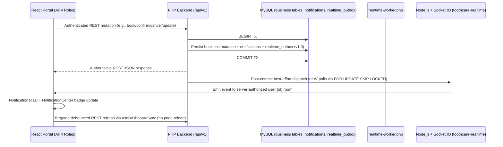

# ToothCare Hub — Unified Real-Time Notification System & Dashboard Synchronization

## Overview

ToothCare Hub operates a single, centralized, persistent, role-aware real-time notification and dashboard synchronization platform shared across all four application roles:

1. **Administrator (`ADMIN`)**
2. **Receptionist (`RECEPTIONIST`)**
3. **Dentist (`DENTIST`)**
4. **Patient (`PATIENT`)**

Built directly on the existing Phase 14 Node.js + Socket.IO service, MySQL transactional outbox (`realtime_outbox`), persistent `notifications` table, and PHP REST API, the system preserves a strict architectural boundary:

> **WebSocket is the real-time delivery mechanism, not the source of truth.**
> PHP and MySQL remain authoritative for business operations, notification persistence, recipient resolution, and access control.

## End-to-End Architecture Flow

## Documentation Index

- [Event Catalog (`event-catalog.md`)](event-catalog.md) — Standardized v1.0 domain events and strict minimal payload contract.
- [Role Recipient Matrix (`recipient-matrix.md`)](recipient-matrix.md) — Server-side DRBAC recipient rules for Admin, Receptionist, Dentist, and Patient.
- [WebSocket Security (`websocket-security.md`)](websocket-security.md) — Single-use tickets, server-controlled rooms, HMAC internal publishing, and session revocation.
- [Notification REST API (`notification-api.md`)](notification-api.md) — Pagination, cursor sync, unread counts, ownership enforcement, and read state.
- [Dashboard Synchronization (`dashboard-sync.md`)](dashboard-sync.md) — Event-to-domain mapping, debouncing, role boundaries, and reconnect recovery.
- [Outbox Worker (`outbox-worker.md`)](outbox-worker.md) — Atomic persistence, `FOR UPDATE SKIP LOCKED`, retries, backoff, and outage recovery.
- [Testing Guide (`testing.md`)](testing.md) — PHPUnit, Node.js Socket.IO, and React Vitest verification suites.
- [Operations Runbook (`operations-runbook.md`)](operations-runbook.md) — Prometheus metrics, health checks, and troubleshooting.
