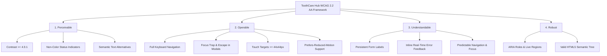

# ToothCare Hub — Accessibility Specification & WCAG 2.2 AA Audit Checklist

**Document ID:** `TCH-P3-A11Y-001`  
**Version:** `1.0.0`  
**Phase:** Phase 3 — Requirements, User Journeys, Wireframes, and Design System  
**Prepared Date:** `2026-10-27`  
**Status:** Approved Baseline  
**Author:** Accessibility Specialist & Frontend Architect  

---

## 1. Accessibility Policy & Target Standard

**ToothCare Hub** is committed to delivering an equitable, barrier-free digital dental health platform. All user interfaces and interactive flows are engineered to satisfy the **Web Content Accessibility Guidelines (WCAG) 2.2 Level AA**.

> [!IMPORTANT]
> **Audit Integrity Notice:** Conformance cannot be claimed purely from documentation, design tokens, or wireframe specifications. True conformance requires rigorous automated testing (axe-core, Lighthouse), keyboard navigation validation, and assistive technology testing (NVDA, VoiceOver) upon component implementation.

---

## 2. Core Accessibility Principles & Technical Rules



### 2.1 Principle 1: Perceivable
1. **Color Contrast:** All normal body text (`#334155` on `#FFFFFF` or `#F5F8FA`) achieves a contrast ratio $> 10:1$, comfortably surpassing the 4.5:1 minimum. Large headings and active brand buttons (`#0D9488` with white text) achieve 4.6:1.
2. **Never Color Alone (WCAG 1.4.1):** Status states (Confirmed, Pending, Completed, Cancelled) must **always** include an accompanying text label and distinct icon (e.g., checkmark for confirmed, clock for pending, red X for cancelled).
3. **Text Alternatives (WCAG 1.1.1):** All icon buttons (close buttons, password reveal eye, notification bell) must declare a programmatic accessible name using `aria-label` or visually hidden screen reader text (`.sr-only`).

### 2.2 Principle 2: Operable
1. **Full Keyboard Accessibility (WCAG 2.1.1):** Every actionable element (links, buttons, slot pickers, table rows, form inputs) must be operable using only the keyboard (`Tab`, `Shift+Tab`, `Space`, `Enter`, `Arrow keys`).
2. **Visible Focus Rings (WCAG 2.4.7 & 2.4.13):** Focus outlines are never removed (`outline: none` is forbidden without an immediate replacement). The system enforces:
   `outline: 2px solid #0D9488; outline-offset: 2px;`
3. **Focus Traps & Modal Management (WCAG 2.4.3):** Opening any dialog (Review Drawer, Cancellation Modal, Walk-In Modal) traps keyboard focus within the dialog container. Pressing `Escape` closes the dialog and restores focus to the triggering element.
4. **Touch Target Size (WCAG 2.5.8):** All interactive targets on mobile viewports enforce a minimum bounding box of **$44 \times 44\text{px}$**.
5. **Motion Preferences (WCAG 2.3.3):** The application strictly honors `prefers-reduced-motion: reduce`, eliminating parallax, background motion, and instant animations.

### 2.3 Principle 3: Understandable
1. **Persistent Form Labels (WCAG 3.3.2):** Placeholders are never used as labels. Form fields pair with persistent visible `<label for="{id}">` elements.
2. **Error Identification & Suggestion (WCAG 3.3.1 & 3.3.3):** Input errors are highlighted immediately with `aria-invalid="true"`, linked to the error container via `aria-describedby="{id}-error"`, and written in clear, non-technical language.
3. **Consistent Identification (WCAG 3.2.4):** Icons and interactive patterns behave identically across the Patient, Dentist, and Admin portals.

### 2.4 Principle 4: Robust
1. **Semantic HTML5 Landmark Regions:** Pages declare `<header>`, `<nav>`, `<main id="main-content">`, `<aside>`, and `<footer>` landmarks.
2. **Skip Links:** Every page incorporates a top skip link (`<a href="#main-content" class="sr-only focus:not-sr-only">Skip to main content</a>`).
3. **Dynamic Feedback & Live Regions:** Real-time Socket.IO alerts and asynchronous toast messages are announced to screen readers using `aria-live="polite"` or `aria-live="assertive"`.

---

## 3. WCAG 2.2 AA Pre-Flight Audit Checklist

| Checkpoint ID | Success Criterion | Implementation Rule | Verified Method |
| :--- | :--- | :--- | :--- |
| **A11Y-01** | 1.1.1 Non-text Content | All SVG icons have `aria-hidden="true"` or descriptive `aria-label`. | axe-core + Code Review |
| **A11Y-02** | 1.3.1 Info and Relationships | Semantic HTML (`h1`-`h4`, `table`, `ul`, `nav`) used exclusively. | DOM Tree Inspection |
| **A11Y-03** | 1.4.1 Use of Color | Appointment status badges pair icon + text + background tint. | Color Blindness Sim |
| **A11Y-04** | 1.4.3 Contrast (Minimum) | Text contrast $\ge 4.5:1$ against surface; large text $\ge 3:1$. | Contrast Analyzer |
| **A11Y-05** | 2.1.1 Keyboard | Zero keyboard traps; all buttons and pickers operable via keyboard. | Manual Keyboard Test |
| **A11Y-06** | 2.4.1 Bypass Blocks | "Skip to main content" link present on every authenticated view. | Tab Navigation Check |
| **A11Y-07** | 2.4.3 Focus Order | Tab sequence follows logical reading and reading layout order. | Manual Keyboard Test |
| **A11Y-08** | 2.4.7 Focus Visible | 2px Teal focus ring clearly visible on all interactive elements. | Visual Keyboard Audit |
| **A11Y-09** | 2.5.8 Target Size (Minimum) | All buttons and controls have $\ge 44 \times 44\text{px}$ touch targets. | Chrome DevTools Tap Audit |
| **A11Y-10** | 3.2.1 On Focus | Focusing an element never automatically triggers form submission or page navigation. | Manual Keyboard Test |
| **A11Y-11** | 3.3.1 Error Identification | Invalid form inputs have `aria-invalid="true"` and visible error text. | Form Submission Testing |
| **A11Y-12** | 3.3.2 Labels or Instructions | All inputs have `<label for="...">` and explicit required markers. | Screen Reader Audit |
| **A11Y-13** | 4.1.2 Name, Role, Value | Custom select dropdowns and modals utilize proper ARIA patterns. | NVDA / VoiceOver Audit |
| **A11Y-14** | 4.1.3 Status Messages | Asynchronous toasts announce via `role="status"` and `aria-live="polite"`. | Screen Reader Event Test |

---

## 4. Screen-Reader Announcement Strategy

```html
<!-- Live Announcement Container for Asynchronous Alerts -->
<div 
  id="a11y-announcer" 
  class="sr-only" 
  role="status" 
  aria-live="polite" 
  aria-atomic="true">
  <!-- Dynamic JavaScript updates inject text here (e.g. "Appointment #1042 confirmed by reception") -->
</div>
```

---

## 5. Verification & Acceptance Criteria
- [x] **AC-A1:** Audit checklist established covering all 14 mandatory WCAG 2.2 Level AA checkpoints.
- [x] **AC-A2:** Non-color status rules enforced across all wireframes and token tables.
- [x] **AC-A3:** Modal focus trap and escape key dismiss procedures formally specified.
