# ToothCare Hub — Use-Case Diagrams & System Boundary

**Document ID:** `TCH-P3-UCD-001`  
**Version:** `1.0.0`  
**Phase:** Phase 3 — Requirements, User Journeys, Wireframes, and Design System  
**Prepared Date:** `2026-10-27`  
**Status:** Approved Baseline  

---

## 1. System Boundary Overview

The ToothCare Hub application boundary encompasses the web-based appointment scheduling, clinic operational administration, real-time messaging, and clinical treatment documentation modules.

```mermaid
flowchart TB
    subgraph ToothCareHub["ToothCare Hub Application Boundary"]
        subgraph AuthBoundary["Authentication & Identity"]
            UC_Reg["Register Account"]
            UC_Login["Log In & Session Init"]
            UC_Logout["Log Out & Revoke Socket"]
            UC_PwReset["Password Reset"]
        end

        subgraph PatientBoundary["Patient Self-Service"]
            UC_Browse["Browse Services & Dentists"]
            UC_Slot["Query Bookable Slots"]
            UC_Request["Submit Appointment Request"]
            UC_ViewAppt["View Own Appointments & Details"]
            UC_CancelAppt["Cancel Own Appointment (<=24h rule)"]
            UC_Reschedule["Request Appointment Reschedule"]
            UC_History["View Visit History & Summary"]
            UC_Notif["View & Sync In-App Notifications"]
        end

        subgraph AdminBoundary["Clinic Administration & Operations"]
            UC_AdmDash["View Clinic KPIs & Dashboard"]
            UC_ReviewQueue["Review Pending Appointment Queue"]
            UC_Approve["Approve Appointment Request"]
            UC_Reject["Reject Appointment Request"]
            UC_AdminCancel["Cancel Appointment with Reason"]
            UC_ManagePatients["Manage Patient Records"]
            UC_ManageDentists["Manage Dentist Profiles & Shifts"]
            UC_ManageServices["Manage Dental Services & Prices"]
            UC_ManageSchedules["Configure Weekly Shifts & Time-Off"]
            UC_AdminReports["Generate & Filter Clinic Reports"]
            UC_AdminAudit["Inspect Security Audit Logs"]
        end

        subgraph DentistBoundary["Dentist Clinical Practice"]
            UC_DenDash["View Assigned Daily Schedule"]
            UC_DenAppt["View Assigned Appointment Details"]
            UC_PatientCtx["Review Assigned Patient Context"]
            UC_RecordNotes["Author Clinical Treatment Notes"]
            UC_CompleteAppt["Mark Attended Visit Completed"]
            UC_DenTimeOff["Request Time-Off / View Leave"]
        end
    end

    %% Actors
    PatientActor(["Patient (PATIENT)"])
    DentistActor(["Dentist (DENTIST)"])
    AdminActor(["Admin / Receptionist (ADMIN)"])

    %% Patient Connections
    PatientActor --> UC_Reg
    PatientActor --> UC_Login
    PatientActor --> UC_Logout
    PatientActor --> UC_PwReset
    PatientActor --> UC_Browse
    PatientActor --> UC_Slot
    PatientActor --> UC_Request
    PatientActor --> UC_ViewAppt
    PatientActor --> UC_CancelAppt
    PatientActor --> UC_Reschedule
    PatientActor --> UC_History
    PatientActor --> UC_Notif

    %% Dentist Connections
    DentistActor --> UC_Login
    DentistActor --> UC_Logout
    DentistActor --> UC_DenDash
    DentistActor --> UC_DenAppt
    DentistActor --> UC_PatientCtx
    DentistActor --> UC_RecordNotes
    DentistActor --> UC_CompleteAppt
    DentistActor --> UC_DenTimeOff
    DentistActor --> UC_Notif

    %% Admin Connections
    AdminActor --> UC_Login
    AdminActor --> UC_Logout
    AdminActor --> UC_AdmDash
    AdminActor --> UC_ReviewQueue
    AdminActor --> UC_Approve
    AdminActor --> UC_Reject
    AdminActor --> UC_AdminCancel
    AdminActor --> UC_ManagePatients
    AdminActor --> UC_ManageDentists
    AdminActor --> UC_ManageServices
    AdminActor --> UC_ManageSchedules
    AdminActor --> UC_AdminReports
    AdminActor --> UC_AdminAudit
    AdminActor --> UC_Notif
```



---

## 2. Patient Actor Use-Case Specifications

```mermaid
useCaseDiagram
    actor "Patient" as P
    package "Patient Capabilities" {
        usecase "UC-P-01: Register Patient Account" as P1
        usecase "UC-P-02: Authenticate & Retrieve Session" as P2
        usecase "UC-P-03: Browse Catalog of Services & Active Dentists" as P3
        usecase "UC-P-04: Query Computed Real-Time Availability" as P4
        usecase "UC-P-05: Submit Appointment Request" as P5
        usecase "UC-P-06: View Status of Own Bookings" as P6
        usecase "UC-P-07: Cancel Booking under Policy Limits" as P7
        usecase "UC-P-08: Reschedule Booking to New Slot" as P8
        usecase "UC-P-09: View Own Visit History & Post-Op Advice" as P9
        usecase "UC-P-10: Receive Real-Time & Recovered In-App Alerts" as P10
    }
    P --> P1
    P --> P2
    P --> P3
    P --> P4
    P --> P5
    P --> P6
    P --> P7
    P --> P8
    P --> P9
    P --> P10
```

### Patient Permissions & Security Enforcements
| Use Case ID | Name | Permission Scope | Invariant / Enforcement Rule |
| :--- | :--- | :--- | :--- |
| `UC-P-01` | Register Account | Public Visitor | Sets `role = 'PATIENT'` strictly. Prohibits administrative role injection. |
| `UC-P-02` | Authenticate | Registered Patient | Issues `HttpOnly`, `SameSite=Lax` cookie and regenerates session ID. |
| `UC-P-03` | Browse Services & Dentists | Public / Patient | Returns only active services (`is_active=1`) and active dentists (`is_active=1`). |
| `UC-P-04` | Query Computed Availability | Public / Patient | Validates `date` within `[NOW() + 2h, NOW() + 60d]`. Excludes `dentist_time_off` and existing `PENDING`/`CONFIRMED` intervals. |
| `UC-P-05` | Submit Appointment Request | Authenticated Patient | Executes inside `SELECT ... FOR UPDATE` row lock. Initial state is always `PENDING`. |
| `UC-P-06` | View Status of Own Bookings | Authenticated Patient | IDOR Filter: `patient.user_id === session.user_id`. Cannot view other patients' bookings. |
| `UC-P-07` | Cancel Booking | Authenticated Patient | Allowed for `PENDING` anytime before `start_at`. Allowed for `CONFIRMED` up to 24 hours prior. Rejects if `< 24h` before `start_at` (`409 Conflict`). |
| `UC-P-08` | Reschedule Booking | Authenticated Patient | Atomic cancel-and-rebook. New appointment starts in `PENDING` status. |
| `UC-P-09` | View History & Advice | Authenticated Patient | Read-only. Exposes post-treatment recommendations; excludes internal clinical notes. |
| `UC-P-10` | Real-Time & Recovered Alerts | Authenticated Patient | Authenticates via short-lived ticket to `user:<id>` socket room; falls back to `GET /api/v1/notifications` on reconnect. |

---

## 3. Dentist Actor Use-Case Specifications

```mermaid
useCaseDiagram
    actor "Dentist" as D
    package "Dentist Clinical Capabilities" {
        usecase "UC-D-01: Log In & Access Clinic Schedule" as D1
        usecase "UC-D-02: View Daily & Upcoming Assigned Schedule" as D2
        usecase "UC-D-03: Access Patient Context for Assigned Appointment" as D3
        usecase "UC-D-04: Author Clinical Treatment Notes" as D4
        usecase "UC-D-05: Mark Confirmed Visit as Completed" as D5
        usecase "UC-D-06: View Own Historical Working Shifts" as D6
        usecase "UC-D-07: Receive Clinical Reassignment Notifications" as D7
    }
    D --> D1
    D --> D2
    D --> D3
    D --> D4
    D --> D5
    D --> D6
    D --> D7
```

### Dentist Permissions & Security Enforcements
| Use Case ID | Name | Permission Scope | Invariant / Enforcement Rule |
| :--- | :--- | :--- | :--- |
| `UC-D-01` | Log In | Active Dentist | Rejects login if `dentists.is_active = 0` or `users.is_active = 0`. |
| `UC-D-02` | View Assigned Schedule | Active Dentist | Query filtered strictly by `appointments.dentist_id === session.dentist_id`. |
| `UC-D-03` | Access Patient Context | Assigned Dentist | Permitted only for patients who hold a `CONFIRMED` or `COMPLETED` appointment with this dentist. Disallows arbitrary patient record browsing. |
| `UC-D-04` | Author Clinical Treatment Notes | Assigned Dentist | Dentist is the exclusive clinical author (`diagnosis`, `treatment_notes`, `recommendations`). Editable within 24h post-completion with audit tracking. |
| `UC-D-05` | Mark Visit Completed | Assigned Dentist | Valid only from `CONFIRMED` status. Appointment date/time must be reached. |
| `UC-D-06` | View Historical Shifts | Active Dentist | Read-only access to own shift rows and planned time-off blocks. |
| `UC-D-07` | Receive Alerts | Active Dentist | Listens on private `dentist:<id>` Socket.IO room for new confirmed bookings or cancellations. |

---

## 4. Admin / Receptionist Actor Use-Case Specifications

```mermaid
useCaseDiagram
    actor "Admin / Receptionist" as A
    package "Clinic Operational Administration" {
        usecase "UC-A-01: Administrative Login & Dashboard KPIs" as A1
        usecase "UC-A-02: Manage Patient Registry" as A2
        usecase "UC-A-03: Manage Dentist Directory & Profiles" as A3
        usecase "UC-A-04: Manage Dental Services Catalog & Prices" as A4
        usecase "UC-A-05: Configure Dentist Schedules & Leave" as A5
        usecase "UC-A-06: Review Pending Appointment Requests" as A6
        usecase "UC-A-07: Approve Request (CONFIRMED)" as A7
        usecase "UC-A-08: Reject Request with Audited Reason" as A8
        usecase "UC-A-09: Cancel / Reschedule Bookings" as A9
        usecase "UC-A-10: Operational Visit Completion Reconciliation" as A10
        usecase "UC-A-11: Generate Clinic Reports & KPI Aggregates" as A11
        usecase "UC-A-12: Review Security Audit Logs" as A12
    }
    A --> A1
    A --> A2
    A --> A3
    A --> A4
    A --> A5
    A --> A6
    A --> A7
    A --> A8
    A --> A9
    A --> A10
    A --> A11
    A --> A12
```

### Admin / Receptionist Permissions & Security Enforcements
| Use Case ID | Name | Permission Scope | Invariant / Enforcement Rule |
| :--- | :--- | :--- | :--- |
| `UC-A-01` | Administrative Dashboard | Admin | Summarizes live counts: pending queue, today's visits, revenue forecast, active dentists. |
| `UC-A-02` | Manage Patient Registry | Admin | Paginated search, view, create, edit contact/emergency info. Cannot impersonate passwords. |
| `UC-A-03` | Manage Dentist Directory | Admin | Create/update dentists, toggle `is_active`. Deactivation preserves historical appointments (`RESTRICT` delete). |
| `UC-A-04` | Manage Service Catalog | Admin | Add/edit services, duration (30/45/60/90m), pricing. Changes snapshot on new bookings without mutating past records. |
| `UC-A-05` | Configure Schedules | Admin | Define recurring weekly shifts (`start_time < end_time`) and insert date/time intervals in `dentist_time_off`. |
| `UC-A-06` | Review Pending Requests | Admin | Priority queue sorted by `created_at ASC` and `start_at ASC`. Highlights overdue requests. |
| `UC-A-07` | Approve Request | Admin | Transitions `PENDING -> CONFIRMED`. Emits real-time event and queues transactional confirmation email. |
| `UC-A-08` | Reject Request | Admin | Transitions `PENDING -> REJECTED`. Requires recording mandatory rejection reason; immediately frees the reserved time slot. |
| `UC-A-09` | Cancel / Reschedule | Admin | Can cancel `PENDING`/`CONFIRMED` bookings at any time with audit reason. Direct rescheduling permitted to `CONFIRMED`. |
| `UC-A-10` | Operational Completion | Admin | Secondary actor allowed to mark `CONFIRMED -> COMPLETED` for administrative checkout reconciliation; cannot author clinical notes. |
| `UC-A-11` | Clinic Reports | Admin | Filter by date range, dentist, service, and status. Enforces server-side pagination (`per_page <= 100`). |
| `UC-A-12` | Inspect Audit Logs | Admin | Read-only access to immutable append-only `audit_logs` and `appointment_status_history`. |

---

## 5. Cross-Role Action Permissibility Matrix

| Operation | Public | Patient | Dentist | Admin | Notes |
| :--- | :---: | :---: | :---: | :---: | :--- |
| **Register Account** | Yes | No | No | No | Admin registers staff via admin dashboard |
| **View Active Services** | Yes | Yes | Yes | Yes | Public catalog |
| **View Inactive Services** | No | No | No | Yes | Administration only |
| **View Dentist Directory** | Active only | Active only | Active + Own | All | Public sees active directory |
| **Query Slot Availability** | Yes | Yes | Yes | Yes | `GET /api/v1/availability` |
| **Create Appointment Request** | No | Own | No | On behalf of patient | Initial status is `PENDING` |
| **Approve Appointment** | No | No | No | Yes | Only `ADMIN` transitions to `CONFIRMED` |
| **Reject Appointment** | No | No | No | Yes | Only `ADMIN` transitions to `REJECTED` |
| **Cancel Appointment** | No | Own (<=24h rule) | No | Yes (Any with reason) | Policy-governed deadline checks |
| **Author Treatment Notes** | No | No | Assigned visit only | No | Clinical licensing requirement |
| **Mark Visit Completed** | No | No | Assigned visit | Yes (Reconciliation) | Precondition: `status = 'CONFIRMED'` |
| **Manage Schedules & Leaves** | No | No | View own | Yes | Admin configures clinic calendar |
| **View Security Audit Logs** | No | No | No | Yes | Tamper-evident admin log |
