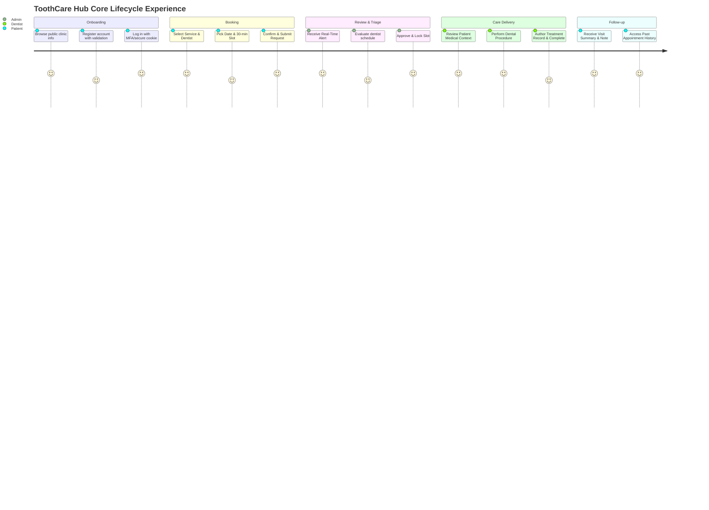

# ToothCare Hub — User Journey Maps & Behavioral Specifications

**Document ID:** `TCH-P3-UJM-001`  
**Version:** `1.0.0`  
**Phase:** Phase 3 — Requirements, User Journeys, Wireframes, and Design System  
**Prepared Date:** `2026-10-27`  
**Status:** Approved Baseline  
**Author:** Lead UX Designer & Frontend Architect  

---

## 1. Executive Summary & Journey Overview

This document specifies the end-to-end user journeys for the six critical scenarios in **ToothCare Hub**. Each journey details:
- **Actor:** Primary and secondary roles involved.
- **Goal:** The desired outcome from the actor's perspective.
- **Preconditions:** System and authentication state before the journey begins.
- **Main Success Scenario:** Step-by-step nominal interaction path.
- **Alternative & Recovery Flows:** Branching logic, edge cases, and user recovery actions.
- **Error & Failure Paths:** Validation errors, network timeouts, concurrency conflicts, and permission rejections.
- **System State Transitions:** Database status changes, audit logging, and caching effects.
- **Security & Authorization Rules:** Frontend route guards vs. backend policy enforcement.
- **UI State Requirements:** Loading skeletons, empty states, validation messages, and accessible notifications.
- **Acceptance Criteria:** Verifiable conditions for testing and sign-off.

---

## 2. Journey Index

| Journey ID | Title | Primary Actor | Trigger Event | Resulting State |
| :--- | :--- | :--- | :--- | :--- |
| **UJ-01** | Patient Registration & Authentication | Patient | Visitor opens app or clicks Register | Authenticated session with JWT in HttpOnly cookie |
| **UJ-02** | 6-Step Appointment Booking Request | Patient | Patient clicks "Book Appointment" | `PENDING` appointment created; slot reserved |
| **UJ-03** | Admin Appointment Review & Decision | Admin | Real-time notification of pending request | Appointment transitioned to `CONFIRMED` or `CANCELLED` |
| **UJ-04** | Dentist Treatment Entry & Visit Completion | Dentist | Dentist opens daily agenda on visit date | Treatment record stored; appointment `COMPLETED` |
| **UJ-05** | Patient Cancellation & Rescheduling | Patient | Patient initiates cancellation from details view | Appointment transitioned to `CANCELLED`; slot released |
| **UJ-06** | Real-Time Notification Delivery & Reconnect Recovery | All Roles | Network disconnection during active session | Persistent notification sync; unread count aligned |

---

## 3. Detailed Journey Specifications



---

### Journey 1: Patient Registration and Login (UJ-01)

#### 1. Context & Metadata
- **Actor:** Prospective Patient (`PATIENT`)
- **Goal:** Create a verified patient identity, establish a secure authenticated session, and navigate directly to the personalized Patient Dashboard.
- **Preconditions:** 
  1. Patient is unauthenticated.
  2. Public registration endpoint is operational.
  3. No session cookie is present.

#### 2. Sequence Diagram
```mermaid
sequenceDiagram
    autonumber
    actor P as Patient
    participant FE as React Frontend (Vite)
    participant API as PHP REST API (Nginx/FPM)
    participant DB as MySQL Database
    participant RT as Node.js Socket.IO

    Note over P,FE: Registration Phase
    P->>FE: Fills registration form (Name, Email, Phone, DOB, Password)
    FE->>FE: Client-side Zod validation (Password strength, phone format)
    alt Validation Failure
        FE-->>P: Displays inline field errors with aria-invalid="true"
    else Validation Passes
        FE->>API: POST /api/auth/register (payload)
        API->>DB: Check email & phone uniqueness
        alt Duplicate Email or Phone
            DB-->>API: Duplicate entry match
            API-->>FE: 409 Conflict {"code": "DUPLICATE_ACCOUNT", "message": "Email already registered."}
            FE-->>P: Banner alert: "Email already registered. Try logging in."
        else Unique Record
            API->>DB: INSERT INTO users, INSERT INTO patients
            DB-->>API: user_id generated
            API-->>FE: 201 Created {"success": true, "message": "Account created successfully."}
            FE-->>P: Toast: "Account created! Please log in." -> Redirects to /login
        end
    end

    Note over P,FE: Authentication Phase
    P->>FE: Enters email and password
    FE->>API: POST /api/auth/login (email, password)
    API->>DB: SELECT user record with role & password hash
    API->>API: Verify argon2id password hash
    alt Invalid Credentials
        API-->>FE: 401 Unauthorized {"code": "INVALID_CREDENTIALS", "message": "Invalid email or password."}
        FE-->>P: Form alert: "Invalid email or password. Please try again."
    else Successful Verification
        API->>API: Generate JWT access token (15m expiry) & refresh token
        API-->>FE: 200 OK + Set-Cookie: token=...; HttpOnly; SameSite=Strict; Secure
        FE->>RT: Socket.IO connect (token via cookie)
        RT-->>FE: Socket connected; joined room "user:patient_id"
        FE-->>P: Redirect to /patient/dashboard
    end
```

#### 3. Main Flow Steps
1. **Access:** Patient navigates to `/register` via top navigation link.
2. **Form Entry:** Patient fills required fields:
   - First Name, Last Name (min 2, max 50 chars).
   - Email Address (valid RFC 5322 format).
   - Phone Number (PH format: `+639XXXXXXXXX` or `09XXXXXXXXX`).
   - Date of Birth (must be $\ge$ 18 years for independent booking, or parent/guardian consent required).
   - Password (min 8 chars, $\ge 1$ uppercase, $\ge 1$ lowercase, $\ge 1$ number, $\ge 1$ special character).
   - Terms & Privacy policy checkbox (mandatory).
3. **Client-Side Validation:** React Hook Form evaluates Zod schema on blur and submit. If invalid, displays immediate red error text with `role="alert"`.
4. **Submission:** Patient submits form; button enters loading state with spinner and text "Creating account...".
5. **Backend Processing:** PHP API checks database uniqueness constraint on `email`. Hashes password using Argon2id with recommended memory and time costs.
6. **Persistence:** Transaction creates parent record in `users` (role `PATIENT`) and linked record in `patients`.
7. **Success Feedback:** Backend returns `201 Created`. Frontend renders accessible success toast and navigates to `/login?registered=true`.
8. **Login Submission:** Patient enters newly created credentials on `/login`.
9. **Token Issue:** Backend validates credentials, issues HttpOnly cookie containing JWT, and returns user profile payload.
10. **Session Initialization:** Frontend stores user context in memory (Redux/Zustand/React Context), initializes Socket.IO connection, and redirects to `/patient/dashboard`.

#### 4. Alternative & Error Flows
- **A1: Duplicate Account:** If the email already exists in `users`, the API responds with `409 Conflict`. The UI highlights the email field and displays: *"An account with this email already exists. [Log in instead](/login)"*.
- **A2: Weak Password:** Client blocks submission; shows a visual password strength meter (Weak / Medium / Strong) and lists unsatisfied criteria.
- **A3: Rate Limiting (Brute Force Defense):** If $> 5$ failed login attempts occur within 15 minutes for the same IP/account, the API returns `429 Too Many Requests` with a `Retry-After: 900` header. The frontend disables the login button and displays a countdown timer.
- **A4: Network Timeout:** If the request exceeds 8 seconds without response, the frontend catches `ECONNABORTED`, resets the submit button, and displays: *"Unable to reach clinic servers. Please check your connection and retry."*

#### 5. System State & Audit Log
- Database: Insert into `users` (`role = 'PATIENT'`, `status = 'ACTIVE'`); insert into `patients` (`user_id`, `first_name`, `last_name`, `dob`, `phone`).
- Audit Log: `INSERT INTO audit_logs (actor_id, action, target_type, target_id, ip_address) VALUES (?, 'AUTH_REGISTER', 'users', ?, ?)`.
- Telemetry: Increment counter `auth_registrations_total`.

---

### Journey 2: 6-Step Appointment Booking Request (UJ-02)

#### 1. Context & Metadata
- **Actor:** Authenticated Patient (`PATIENT`)
- **Goal:** Book a dental appointment by selecting service, dentist, date, and 30-minute time slot with atomic conflict validation.
- **Preconditions:**
  1. Patient is logged in with active session.
  2. Clinic services, active dentists, and weekly schedules are populated.
  3. Current clinic time zone: `Asia/Manila` (`UTC+08:00`).

#### 2. Sequence Diagram
```mermaid
sequenceDiagram
    autonumber
    actor P as Patient
    participant W as Booking Wizard (UI)
    participant API as PHP REST API
    participant DB as MySQL Database
    participant RT as Realtime Server (Socket.IO)
    actor A as Admin

    P->>W: Navigates to /patient/appointments/new
    W->>API: GET /api/services (active=true)
    API-->>W: Array of Dental Services (name, duration, price)
    
    Note over P,W: Step 1: Service Selection
    P->>W: Selects "Dental Prophylaxis (Cleaning)" (45m, ₱1,500)
    
    Note over P,W: Step 2: Dentist Selection
    W->>API: GET /api/dentists?service_id=1
    API-->>W: List of available dentists
    P->>W: Selects "Dr. Maria Santos, DMD" (or "Any Available")
    
    Note over P,W: Step 3: Date & Slot Selection
    P->>W: Selects Date: "2026-11-03" (Tuesday)
    W->>API: GET /api/dentists/1/availability?date=2026-11-03
    API->>DB: Query working shifts, time-offs, and existing (PENDING/CONFIRMED) appointments
    DB-->>API: Result set of occupied slots
    API->>API: Calculate free 30-min start slots covering 45 min duration
    API-->>W: Array of available slots: ["09:00", "09:30", "11:00", "14:00"]
    P->>W: Clicks slot "09:30 AM"
    
    Note over P,W: Step 4: Patient Medical Notes
    P->>W: Enters chief complaint: "Routine 6-month cleaning, slight gum bleeding"
    
    Note over P,W: Step 5: Review & Confirmation
    W->>P: Displays Summary Card (Service, Dentist, Date, Time, Cost, Notice)
    P->>W: Clicks "Confirm & Request Appointment"
    
    Note over W,API: Step 6: Atomic Submission & Concurrency Lock
    W->>API: POST /api/appointments {dentist_id, service_id, start_at, notes}
    API->>DB: START TRANSACTION; SELECT FOR UPDATE (check overlapping slots)
    alt Slot Concurrency Race (Slot Already Taken)
        DB-->>API: Overlap found with active appointment
        API->>DB: ROLLBACK
        API-->>W: 409 Conflict {"code": "SLOT_OCCUPIED", "message": "This slot was just booked by another patient."}
        W-->>P: Error Modal: "Slot no longer available. Please choose another time." -> Refreshes slots
    else Slot Clean & Valid
        API->>DB: INSERT INTO appointments (status='PENDING', ...)
        API->>DB: INSERT INTO notifications (recipient_role='ADMIN', ...)
        API->>DB: COMMIT
        API->>RT: emit("appointment_created", {appointment_id, patient_name, slot})
        RT->>A: socket.emit("new_pending_request", payload)
        API-->>W: 201 Created {appointment_id: 1042, status: "PENDING"}
        W-->>P: Success Screen + Redirect to /patient/appointments/1042
    end
```

#### 3. Main Flow Steps
1. **Step 1 — Service Selection:** Patient reviews service cards displaying category (Preventive, Restorative, Cosmetic), duration, price range, and description. Patient clicks card to select.
2. **Step 2 — Dentist Selection:** Wizard renders available dentists offering the chosen service. Cards display photo/avatar, dental license/specialty, next available date, and bio. Option "Any Available Dentist" is highlighted to maximize scheduling flexibility.
3. **Step 3 — Date & Time Slot Selection:**
   - Calendar grid highlights days with available shifts (past dates and clinic holidays disabled).
   - Selection triggers an availability fetch for `date` and `dentist_id`.
   - Grid renders discrete 30-minute pill buttons (e.g., `09:00 AM`, `09:30 AM`).
   - Unavailable slots are marked disabled (`aria-disabled="true"`) with visual slash-through and muted background.
   - Patient clicks available pill; button transitions to selected teal state.
4. **Step 4 — Chief Complaint & Medical Notes:** Optional textarea for patient to enter symptoms, allergies, or special accommodation requests (max 500 chars with visible counter).
5. **Step 5 — Review & Verification:** Patient views high-contrast summary table:
   - Service: *Dental Prophylaxis (Cleaning)* (45 mins)
   - Dentist: *Dr. Maria Santos, DMD*
   - Date: *Tuesday, November 3, 2026*
   - Time: *09:30 AM – 10:15 AM* (`Asia/Manila`)
   - Estimated Fee: *₱1,500.00*
   - Policy Notice: *"Appointments are subject to clinic approval. Cancellations must be made at least 24 hours in advance."*
6. **Step 6 — Atomic Submission:** Patient clicks *"Submit Request"*. System executes atomic transaction check.
7. **Confirmation Feedback:** Screen presents green checkmark illustration, appointment reference number `#APP-1042`, status badge `Pending Approval`, and action button *"View My Appointments"*.

#### 4. Concurrency & Race Condition Defense
- **The Double-Booking Problem:** Two patients select the identical slot `09:30 AM` concurrently.
- **Defense Mechanism:**
  1. The API endpoint `POST /api/appointments` opens a database transaction with `ISOLATION LEVEL REPEATABLE READ`.
  2. Executes:
     ```sql
     SELECT id FROM appointments 
     WHERE dentist_id = :dentist_id 
       AND status IN ('PENDING', 'CONFIRMED')
       AND start_at < :req_end_at 
       AND end_at > :req_start_at 
     FOR UPDATE;
     ```
  3. If count $> 0$, rolls back immediately and returns HTTP `409 Conflict`.
  4. Frontend catches `409`, displays inline warning alert, automatically re-queries `/availability`, and highlights nearest alternative slots.

---

### Journey 3: Admin Appointment Review & Decision (UJ-03)

#### 1. Context & Metadata
- **Actor:** Clinic Administrator / Receptionist (`ADMIN`)
- **Goal:** Review incoming pending appointment requests, verify dentist scheduling availability, and approve or reject with audit trail and real-time patient notification.
- **Preconditions:**
  1. Admin is authenticated and on `/admin/dashboard` or `/admin/appointments`.
  2. One or more appointments exist in `PENDING` status.

#### 2. Sequence Diagram
```mermaid
sequenceDiagram
    autonumber
    actor A as Admin
    participant UI as Admin Dashboard
    participant API as PHP REST API
    participant DB as MySQL Database
    participant RT as Realtime Server
    actor P as Patient

    Note over UI,RT: Real-Time Event Arrival
    RT->>UI: socket.emit("new_pending_request", {id: 1042, patient: "John Doe"})
    UI->>UI: Increment pending badge count; play subtle sound; prepend item to table
    
    A->>UI: Clicks "Review" button on appointment #1042
    UI->>API: GET /api/admin/appointments/1042
    API-->>UI: Full detail payload (Patient record, service, conflicts check, visit history)
    UI->>A: Opens Appointment Review Slide-Over Drawer
    
    alt Admin Approves Request
        A->>UI: Clicks "Approve Appointment"
        UI->>API: POST /api/admin/appointments/1042/approve
        API->>DB: UPDATE appointments SET status='CONFIRMED', reviewed_by=admin_id, reviewed_at=NOW()
        API->>DB: INSERT INTO notifications (user_id=patient_user_id, type='APPOINTMENT_CONFIRMED')
        API->>RT: emit("appointment_status_changed", {id: 1042, status: 'CONFIRMED'})
        RT->>P: socket.emit("notification", {title: "Appointment Confirmed!", time: "Nov 3, 09:30 AM"})
        API-->>UI: 200 OK {"status": "CONFIRMED"}
        UI-->>A: Toast: "Appointment #1042 approved successfully." Badge changes to Confirmed (Teal)
    else Admin Rejects Request
        A->>UI: Clicks "Reject Request"
        UI->>A: Prompts Modal: "Select Rejection Reason" (Dentist Unavailable, Clinic Maintenance, Other)
        A->>UI: Selects reason: "Dentist called in emergency leave" + notes
        UI->>API: POST /api/admin/appointments/1042/reject {reason, note}
        API->>DB: UPDATE appointments SET status='CANCELLED', cancellation_reason=?, cancelled_by=admin_id
        API->>DB: INSERT INTO notifications (user_id=patient_user_id, type='APPOINTMENT_REJECTED')
        API->>RT: emit("appointment_status_changed", {id: 1042, status: 'CANCELLED'})
        RT->>P: socket.emit("notification", {title: "Appointment Not Approved", reason: "..."})
        API-->>UI: 200 OK {"status": "CANCELLED"}
        UI-->>A: Toast: "Appointment #1042 rejected. Slot released."
    end
```

#### 3. Main Flow Steps
1. **Queue Inspection:** Admin navigates to `/admin/appointments` with tab filtered to `Pending (3)`.
2. **Context Inspection:** Admin clicks appointment row to open the review drawer. Drawer displays:
   - Patient demographics, contact numbers, and past visit count.
   - Selected procedure, requested dentist, exact date and start/end time.
   - Conflict detector widget: *"Zero dentist overlaps found. Chair 2 available."*
3. **Approval Action:** Admin clicks *"Approve Appointment"* (Primary Teal button).
4. **Backend State Transition:**
   - Database executes: `UPDATE appointments SET status = 'CONFIRMED', updated_at = NOW() WHERE id = 1042 AND status = 'PENDING'`.
   - Generates in-app notification record and pushes real-time event to Patient room.
5. **UI Update:** Row status transitions dynamically from Amber `Pending` badge to Teal `Confirmed` badge with smooth CSS animation.

#### 4. Alternative & Error Flows
- **A1: Simultaneous Rejection / Stale View:** If another receptionist already processed the request, the API returns `409 Conflict: Appointment already processed by Admin #2`. The UI invalidates the cache, refetches the appointment record, and updates the drawer to display the current status.
- **A2: Rejection with Custom Guidance:** When rejecting, the admin can check *"Suggest alternative slot"* and specify a date/time. This note is embedded in the patient's notification.

---

### Journey 4: Dentist Treatment Record Entry & Visit Completion (UJ-04)

#### 1. Context & Metadata
- **Actor:** Attending Dentist (`DENTIST`)
- **Goal:** Review patient appointment context, enter clinical treatment findings and procedures performed, and mark the visit `COMPLETED`.
- **Preconditions:**
  1. Dentist is logged in and assigned to the appointment.
  2. Appointment status is `CONFIRMED`.
  3. Current date matches or is after appointment `start_at`.

#### 2. Sequence Diagram
```mermaid
sequenceDiagram
    autonumber
    actor D as Dentist
    participant UI as Dentist Portal (React)
    participant API as PHP REST API
    participant DB as MySQL Database

    D->>UI: Navigates to /dentist/dashboard
    UI->>API: GET /api/dentist/appointments?date=today
    API-->>UI: Array of today's assigned appointments
    D->>UI: Clicks appointment #1042 ("John Doe - 09:30 AM")
    
    UI->>API: GET /api/dentist/appointments/1042
    API->>DB: SELECT appointment, patient medical profile, past treatments
    DB-->>API: Patient Context Data
    API-->>UI: Detail payload with Clinical Form
    
    Note over D,UI: Clinical Documentation
    D->>UI: Enters Treatment Form:
    Note right of D: 1. Teeth Treated (#14, #15)<br/>2. Diagnosis ("Mild subgingival calculus")<br/>3. Procedure Performed ("Scaling & polishing")<br/>4. Post-Treatment Advice ("Soft bristle brush, chlorhexidine rinse")
    
    D->>UI: Clicks "Complete Visit & Save Record"
    UI->>D: Prompts Confirmation Dialog: "Finalize Treatment Record? This marks appointment Completed."
    D->>UI: Clicks "Confirm Completion"
    
    UI->>API: POST /api/dentist/appointments/1042/complete {teeth, diagnosis, procedure, notes}
    API->>DB: START TRANSACTION
    API->>DB: INSERT INTO treatments (appointment_id, dentist_id, patient_id, diagnosis, procedure_notes, ...)
    API->>DB: UPDATE appointments SET status = 'COMPLETED', completed_at = NOW()
    API->>DB: INSERT INTO audit_logs (...)
    API->>DB: COMMIT
    API-->>UI: 200 OK {"status": "COMPLETED", "treatment_id": 501}
    UI-->>D: Success Toast: "Visit completed. Treatment record archived."
    UI->>UI: Transitions status badge to Completed (Blue/Teal); locks form to read-only
```

#### 3. Main Flow Steps
1. **Schedule Access:** Dentist opens `/dentist/dashboard` on clinic tablet or desktop. Sees chronological agenda for the day with patient names, procedures, and status chips.
2. **Patient Review:** Dentist selects active patient. Reads allergies (e.g., *"Penicillin allergy"* in red badge) and chief complaint entered during booking.
3. **Clinical Documentation:** Dentist fills out standardized treatment fields:
   - Teeth Numbers (multiselect picker / FDI two-digit dental notation: 11 to 48).
   - Clinical Diagnosis / Findings (min 10 chars).
   - Procedure Rendered (pre-populated with booked service, editable for added procedures).
   - Prescriptions & Home Care Instructions (e.g., analgesic dosages, follow-up recommendations).
4. **Validation:** React Hook Form validates required diagnosis and procedure text.
5. **Confirmation:** Dentist clicks *"Finalize & Complete Appointment"*. Dialog requires explicit acknowledgement.
6. **Persistence & State Change:** Backend writes record to `treatments`, sets `appointments.status = 'COMPLETED'`, and generates an audit record.
7. **Post-Completion State:** Form enters read-only view. Per clinic policy, treatment records may be edited by the authoring dentist for up to 24 hours post-completion; after 24 hours, the record is locked permanently.

#### 4. Scope & Privacy Guardrails
- **Restricted Patient Access:** A dentist can **only** access medical histories and contact details for patients explicitly assigned to their scheduled appointments. Indiscriminate browsing of the global patient database is blocked by backend middleware (`403 Forbidden`).
- **No Unapproved Fields:** The form is restricted strictly to approved MVP clinical fields: `diagnosis`, `procedure_notes`, `teeth_treated`, `prescription_notes`, and `follow_up_recommendation`. Expanded EHR fields (imaging DICOM files, odontograms) are excluded from Phase 3.

---

### Journey 5: Patient Appointment Cancellation & Rescheduling (UJ-05)

#### 1. Context & Metadata
- **Actor:** Patient (`PATIENT`)
- **Goal:** Cancel a booked appointment or reschedule to a new slot within approved clinic policy deadlines.
- **Preconditions:**
  1. Patient is logged in.
  2. Appointment belongs to the requesting patient (`patient_id = auth_user.patient_id`).
  3. Status is either `PENDING` or `CONFIRMED`.

#### 2. Sequence Diagram
```mermaid
sequenceDiagram
    autonumber
    actor P as Patient
    participant UI as Patient Portal
    participant API as PHP REST API
    participant DB as MySQL Database
    participant RT as Realtime Server
    actor A as Admin

    P->>UI: Navigates to /patient/appointments/1042
    UI->>UI: Calculates time delta: (appointment.start_at - NOW())
    
    alt Status is PENDING
        UI->>UI: Renders "Cancel Request" (Always Allowed)
    else Status is CONFIRMED and Delta >= 24 Hours
        UI->>UI: Renders "Cancel Appointment" (Within Policy Window)
    else Status is CONFIRMED and Delta < 24 Hours
        UI->>UI: Renders "Cancel Unavailable" + Tooltip: "Late cancellations require clinic call at (02) 8123-4567"
    end

    P->>UI: Clicks "Cancel Appointment"
    UI->>P: Displays Confirmation Modal (Prompts reason & confirms slot forfeiture)
    P->>UI: Selects reason: "Personal emergency / Conflict" and confirms
    
    UI->>API: POST /api/patient/appointments/1042/cancel {reason: "Personal emergency"}
    API->>DB: SELECT start_at, status FROM appointments WHERE id = 1042 FOR UPDATE
    
    alt Backend Policy Check: Delta < 24h on Confirmed Appointment
        API-->>UI: 422 Unprocessable Entity {"code": "LATE_CANCELLATION_RESTRICTED", "message": "Cancellations within 24 hours must be processed by clinic reception."}
        UI-->>P: Banner Alert with Clinic Phone Link
    else Eligible for Cancellation
        API->>DB: UPDATE appointments SET status = 'CANCELLED', cancelled_by = user_id, cancellation_reason = ?, cancelled_at = NOW()
        API->>DB: INSERT INTO notifications (role = 'ADMIN', ...)
        API->>RT: emit("appointment_cancelled", {id: 1042, dentist_id: 1, slot: "2026-11-03 09:30"})
        RT->>A: socket.emit("admin_alert", {text: "Appointment #1042 cancelled. Slot 09:30 AM released."})
        API-->>UI: 200 OK {"status": "CANCELLED"}
        UI-->>P: Success Toast: "Appointment cancelled. The slot has been released."
        UI->>UI: Updates status chip to Cancelled (Slate/Red); removes cancel button
    end
```

#### 3. Main Flow Steps
1. **Details Access:** Patient opens appointment `#1042` from dashboard or appointments list.
2. **Policy Evaluation:** UI evaluates eligibility rules:
   - If status = `PENDING`: Patient may cancel at any time prior to admin review.
   - If status = `CONFIRMED`: Cancellation is permitted up to **24 hours** prior to scheduled start time (`start_at`).
   - If time remaining $< 24$ hours: Cancellation button is replaced with contact banner: *"Late cancellations require calling our reception directly at (02) 8123-4567."*
3. **Dialog Confirmation:** Patient clicks *"Cancel Appointment"*. Accessible dialog opens (`role="alertdialog"`). Patient selects a required reason from a dropdown (*Schedule conflict, Illness, Financial reasons, Other*).
4. **Backend Enforcement:** The PHP API re-verifies the 24-hour rule on the server side using the clinic time zone (`Asia/Manila`).
5. **State Update & Slot Release:** Appointment is updated to `CANCELLED`. The dentist's schedule is immediately unblocked for new bookings.
6. **Real-Time Notification:** Socket event informs reception that a slot has freed up.

#### 4. Rescheduling Workflow
- Rescheduling follows an **atomic cancel-and-rebook** design pattern:
  1. Patient clicks *"Reschedule"*.
  2. Booking Wizard opens pre-populated with original service and dentist.
  3. Patient picks a new available date and time.
  4. On confirmation, the API atomically executes:
     - Old appointment: status changed to `CANCELLED` with reason `"Rescheduled to #APP-1088"`.
     - New appointment: created in `PENDING` status with `rescheduled_from_id = 1042`.
  5. If new slot booking fails, the original appointment remains intact (atomic rollback).

---

### Journey 6: Real-Time Notification Delivery & Reconnect Recovery (UJ-06)

#### 1. Context & Metadata
- **Actor:** All Roles (`PATIENT`, `DENTIST`, `ADMIN`)
- **Goal:** Receive instantaneous in-app alerts during active sessions; seamlessly recover missed notifications following network drops, sleep mode, or tab backgrounding.
- **Preconditions:**
  1. User is authenticated.
  2. Notifications table exists in MySQL as source of truth.
  3. Node.js Socket.IO server is running on port 4000.

#### 2. Sequence Diagram
```mermaid
sequenceDiagram
    autonumber
    actor U as User (Any Role)
    participant App as React App (Browser)
    participant RT as Node.js Socket.IO Server
    participant API as PHP REST API
    participant DB as MySQL Database

    Note over App,RT: Phase 1: Real-Time Connection
    App->>RT: Connects to wss://toothcare.local/socket.io/?token=JWT
    RT->>RT: Verifies JWT signature & claims
    RT-->>App: Event: "connect" -> App sets connectionStatus = "ONLINE"
    RT->>RT: socket.join("user:" + user_id)

    Note over App,RT: Phase 2: Network Drop
    App->>App: User loses WiFi / closes laptop lid
    RT->>RT: Ping timeout (20s) -> Socket disconnected
    App->>App: window "offline" event -> UI shows subtle toast: "Connection lost. Reconnecting..."

    Note over App,API: Phase 3: Network Restoration & Sync
    App->>App: window "online" event fired
    App->>RT: Socket.IO automatic reconnection attempt (exponential backoff)
    RT-->>App: Event: "reconnect" -> connectionStatus = "ONLINE"
    
    Note over App,API: Phase 4: REST Recovery & Deduplication
    App->>API: GET /api/notifications?since={last_received_timestamp}&limit=50
    API->>DB: SELECT * FROM notifications WHERE user_id = ? AND created_at > ? ORDER BY created_at DESC
    DB-->>API: Array of missed notifications [Notif #88, Notif #89]
    API-->>App: 200 OK {notifications: [...], unread_count: 3}
    
    App->>App: Deduplicate against in-memory notification store (by notification_id)
    App->>App: Update unread badge count in Navbar
    App->>App: Play subtle sound for missed high-priority items
    
    Note over U,App: Phase 5: User Reads Notification
    U->>App: Opens Notification Drawer & clicks Notification #88
    App->>API: PATCH /api/notifications/88/read
    API->>DB: UPDATE notifications SET read_at = NOW() WHERE id = 88
    DB-->>API: 200 OK
    App->>App: Decrement unread badge; navigate to referenced appointment #1042
```

#### 3. Main Flow Steps
1. **Initial Handshake:** On application mount, the notification provider initializes a Socket.IO connection passing the auth token.
2. **Channel Subscription:** Server joins the socket to private channels:
   - `user:{user_id}`: Targeted personal alerts.
   - `role:{role}`: Role-wide broadcasts (e.g., all admins notified of new bookings).
3. **Disconnection Detection:** When the browser detects offline status (`navigator.onLine === false`) or Socket.IO emits `disconnect`, the UI toggles an internal state flag. A non-obtrusive amber indicator displays in the top navigation: *"Offline — Changes will sync when reconnected"*.
4. **Reconnection & REST Fetch:** Upon reconnection, Socket.IO resumes, but the client **never assumes** zero lost packets. Instead, it dispatches an immediate REST call:
   `GET /api/notifications?since_id=145&unread_only=false`
5. **Deduplication:** Frontend combines incoming REST data with local state using a `Map<id, Notification>` structure, eliminating duplicates.
6. **Badge & Drawer Synchronization:** The unread count badge in the top navigation reflects the verified database count.
7. **Marking as Read:** Clicking an individual notification sends `PATCH /api/notifications/:id/read`; clicking *"Mark all as read"* dispatches `POST /api/notifications/mark-all-read`.

#### 4. Alternative & Resilience Rules
- **Server Restart / Socket Crash:** If the Socket.IO service crashes, the React app automatically falls back to periodic REST polling (`interval: 60 seconds`) until WebSocket connectivity is restored.
- **Zero Notification Loss:** All notification records are persisted in MySQL **before** any socket event is emitted. The WebSocket is treated strictly as an optimization pipeline, never as primary storage.

---

## 4. Journey Matrix: Cross-Role Permissions & Touchpoints

| Scenario | Patient (`PATIENT`) | Dentist (`DENTIST`) | Admin / Receptionist (`ADMIN`) |
| :--- | :--- | :--- | :--- |
| **Registration / Login** | Self-registers; authenticates to patient area | Provisioned by Admin; logs in to dentist portal | Seeded / provisioned; logs in to admin console |
| **Booking Creation** | Authors request for own profile | Cannot book for patient in MVP | Can book on behalf of walking-in patients |
| **Appointment Review** | Views `PENDING` status | Views confirmed assigned slots only | Approves or Rejects with recorded reasons |
| **Treatment Records** | Reads finalized treatment summary | Exclusive author of clinical diagnosis/notes | Views billing summary; cannot edit clinical notes |
| **Cancellation** | Self-cancels if $\ge 24$h before start | Can flag emergency unavailable to admin | Can cancel any appointment with administrative reason |
| **Notifications** | Receives status changes & reminders | Receives daily assignment & schedule updates | Receives queue alerts, cancellations, daily stats |

---

## 5. Verification & Acceptance Criteria

- [x] **AC-J1:** Registration form rejects passwords $< 8$ characters and duplicate emails with accessible error messages.
- [x] **AC-J2:** Double-booking test: When two parallel requests target the identical dentist and slot, exactly one succeeds (`201`) and the other receives `409 Conflict`.
- [x] **AC-J3:** Admin approval updates status to `CONFIRMED` in $< 300\text{ms}$ and emits real-time event to the specific patient socket room.
- [x] **AC-J4:** Dentist can only edit treatment notes for appointments where `dentist_id == auth.dentist_id`; unauthorized access returns `403`.
- [x] **AC-J5:** Cancellation is blocked both client-side and server-side if confirmed appointment is $< 24$ hours from start time.
- [x] **AC-J6:** Disconnecting network, firing 3 notifications, and reconnecting results in exact reconciliation of all 3 notifications without page refresh.
