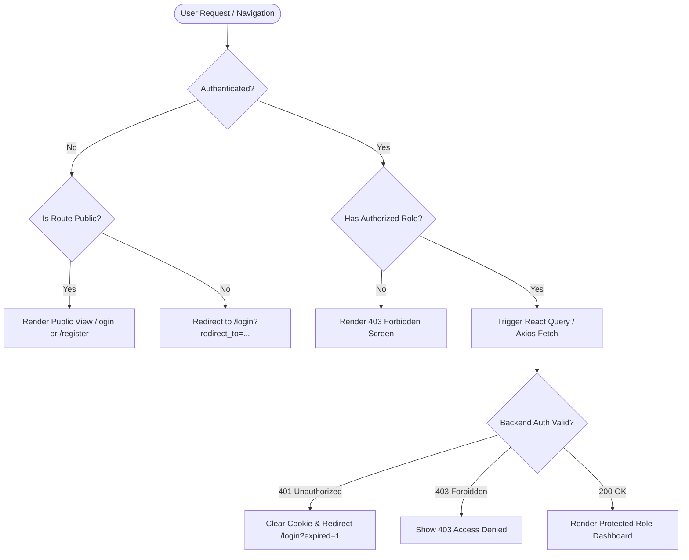

# ToothCare Hub — Information Architecture & Route Map

**Document ID:** `TCH-P3-IAM-001`  
**Version:** `1.0.0`  
**Phase:** Phase 3 — Requirements, User Journeys, Wireframes, and Design System  
**Prepared Date:** `2026-10-27`  
**Status:** Approved Baseline  
**Author:** Lead Frontend Architect & Systems Designer  

---

## 1. Architectural Principles & Security Boundary

In **ToothCare Hub**, routing is structured around two non-negotiable architectural principles:
1. **Client-Side Route Guards are UX Enablers, Not Security Boundaries:** Frontend guards (implemented in React Router v6) prevent flickering and guide users to valid workflows. However, the **PHP REST API strictly enforces authentication and role-based permissions (`RBAC`) on every protected endpoint**.
2. **Deep-Linking & Deterministic State Recovery:** Protected routes preserve the requested URL in a `redirect_url` query parameter upon session timeout or authentication redirect, enabling seamless post-login restoration.

---

## 2. Global Route Hierarchy Table

| Route Path | Page Title | Authorized Roles | Purpose | Expected API Endpoints | Post-Action / Fallback |
| :--- | :--- | :--- | :--- | :--- | :--- |
| **`/`** | Welcome — ToothCare Hub | Public (`ALL`) | Landing page & clinic overview | `GET /api/public/clinic-info` | Redirects to role dashboard if authenticated |
| **`/login`** | Log In — ToothCare Hub | Public (`ANON`) | User authentication | `POST /api/auth/login` | Routes to role dashboard |
| **`/register`** | Register — ToothCare Hub | Public (`ANON`) | Patient account creation | `POST /api/auth/register` | Redirects to `/login?registered=1` |
| **`/forgot-password`** | Password Recovery | Public (`ALL`) | Request reset link / OTP | `POST /api/auth/forgot-password` | Success notice |
| **`/patient/dashboard`** | Patient Dashboard | `PATIENT` | Next visit, quick actions, status | `GET /api/patient/dashboard` | Shows empty state if zero appointments |
| **`/patient/appointments`**| My Appointments | `PATIENT` | List of upcoming/past visits | `GET /api/patient/appointments` | Filterable by status |
| **`/patient/appointments/new`**| Book Appointment | `PATIENT` | 6-step multi-step booking wizard | `GET /api/services`, `GET /api/availability`, `POST /api/appointments` | Navigates to `/patient/appointments/:id` |
| **`/patient/appointments/:id`**| Appointment Details | `PATIENT` | View appointment detail & cancel | `GET /api/patient/appointments/:id`, `POST /.../cancel` | Slide drawer / detail view |
| **`/patient/history`** | Visit History | `PATIENT` | Archived treatments & past bills | `GET /api/patient/history` | Treatment summaries |
| **`/patient/notifications`** | Notifications | `PATIENT` | Real-time & persistent alerts | `GET /api/notifications` | Drawer / page view |
| **`/admin/dashboard`** | Clinic Dashboard | `ADMIN` | Daily KPIs, agenda, triage alerts | `GET /api/admin/dashboard` | Main admin landing |
| **`/admin/appointments`**| Appointment Triage | `ADMIN` | Review pending queue & manage all | `GET /api/admin/appointments`, `POST /.../approve`, `POST /.../reject` | Real-time queue updates |
| **`/admin/patients`** | Patient Directory | `ADMIN` | Master patient list & walk-in add | `GET /api/admin/patients`, `POST /api/admin/patients` | Search & detail drawer |
| **`/admin/dentists`** | Dentist Roster | `ADMIN` | Manage practitioners & chairs | `GET /api/admin/dentists`, `POST /.../dentists` | Manage shifts modal |
| **`/admin/services`** | Services & Pricing | `ADMIN` | Procedures, duration, fees | `GET /api/services`, `POST /api/services` | Edit modal |
| **`/admin/schedules`** | Clinic Schedules | `ADMIN` | Weekly shifts, chairs, time-off | `GET /api/admin/schedules`, `POST /.../shifts` | Week matrix view |
| **`/admin/reports`** | Clinic Reports | `ADMIN` | Operational KPIs & statistics | `GET /api/admin/reports` | Exportable CSV / charts |
| **`/admin/notifications`**| Admin Alerts | `ADMIN` | Queue alerts, cancellations | `GET /api/notifications` | Drawer view |
| **`/dentist/dashboard`**| Dentist Practice | `DENTIST` | Daily timeline, active patients | `GET /api/dentist/dashboard` | Main dentist landing |
| **`/dentist/appointments`**| Assigned Schedule | `DENTIST` | Weekly/daily assigned visits | `GET /api/dentist/appointments` | Filterable agenda |
| **`/dentist/appointments/:id`**| Clinical Context | `DENTIST` | Medical profile & chief complaint | `GET /api/dentist/appointments/:id` | Restricted to assigned practitioner |
| **`/dentist/treatments/new`**| Clinical Record Entry | `DENTIST` | Author diagnosis, teeth, notes | `POST /api/dentist/treatments` | Transitions appointment to `COMPLETED` |
| **`/dentist/treatments/:id`** | View/Edit Treatment | `DENTIST` | Read/modify notes (<=24h rule) | `GET/PUT /api/dentist/treatments/:id` | Read-only after 24h |
| **`/dentist/notifications`**| Practice Alerts | `DENTIST` | Shift updates, assignments | `GET /api/notifications` | Drawer view |
| **`*` (Wildcard)** | Page Not Found | Public (`ALL`) | 404 Error handler | None | Link back to home / dashboard |

---

## 3. Session & Navigation Behaviors

### 3.1 Default Post-Login Routing
When a user authenticates at `/login`:
- If `redirect_to` query parameter exists and is a valid relative path $\rightarrow$ Redirect to `redirect_to`.
- Else If user role is `ADMIN` $\rightarrow$ Redirect to `/admin/dashboard`.
- Else If user role is `DENTIST` $\rightarrow$ Redirect to `/dentist/dashboard`.
- Else If user role is `PATIENT` $\rightarrow$ Redirect to `/patient/dashboard`.

### 3.2 Unauthenticated Access to Protected Routes
If an unauthenticated visitor attempts to navigate to any protected route (e.g., `/patient/appointments/new`):
- React Router guard intercepts navigation immediately.
- Dispatches redirect to: `/login?redirect_to=%2Fpatient%2Fappointments%2Fnew`.
- Displays subtle informational toast: *"Please log in to access this page."*

### 3.3 Unauthorized Role Access (403 Forbidden)
If a user with role `PATIENT` attempts to navigate to `/admin/services`:
- Guard verifies role against authorized roles array `['ADMIN']`.
- Renders dedicated `403 Forbidden` screen:
  - Header: *"Access Denied"*
  - Body: *"You do not have the required clinic permissions to view this resource."*
  - Primary Action: `[ Return to Your Dashboard ]` (links to `/patient/dashboard`).

### 3.4 Session Expiration During Active Use
If the user's JWT expires (15-minute token lifetime) and refresh fails:
- The Axios/Fetch HTTP interceptor catches `401 Unauthorized`.
- Dispatches event to AuthStore to clear user session and disconnect Socket.IO.
- Preserves current pathname and redirects to `/login?expired=1&redirect_to=${encodeURIComponent(location.pathname)}`.
- Login screen renders alert banner: `[!] Your session has expired. Please log in again to continue.`

### 3.5 Logout Behavior
When user clicks *"Log Out"*:
1. Client calls `POST /api/auth/logout` to invalidate token and clear HttpOnly cookie.
2. Disconnects active Socket.IO client connection.
3. Clears in-memory state stores (Zustand/Redux).
4. Navigates to `/login?logout=1`.
5. Displays accessible feedback toast: *"You have been logged out successfully."*

---

## 4. Unknown Route Handling (404 Not Found)

Any unmapped path (e.g., `/invalid-path`) renders the accessible `404 Not Found` screen:
- Title: *"Page Not Found — ToothCare Hub"*
- Visual: Friendly dental mirror / map illustration.
- Message: *"The page you requested could not be found or may have been relocated."*
- Action: `[ Back to Home / Dashboard ]`.

---

## 5. Verification & Acceptance Criteria
- [x] **AC-R1:** All 24 routes mapped with designated role guards and API requirements.
- [x] **AC-R2:** Deep linking preserves query parameters and restores intended destination post-login.
- [x] **AC-R3:** Unauthorized cross-role navigation is intercepted immediately without exposing sensitive layout shells.
