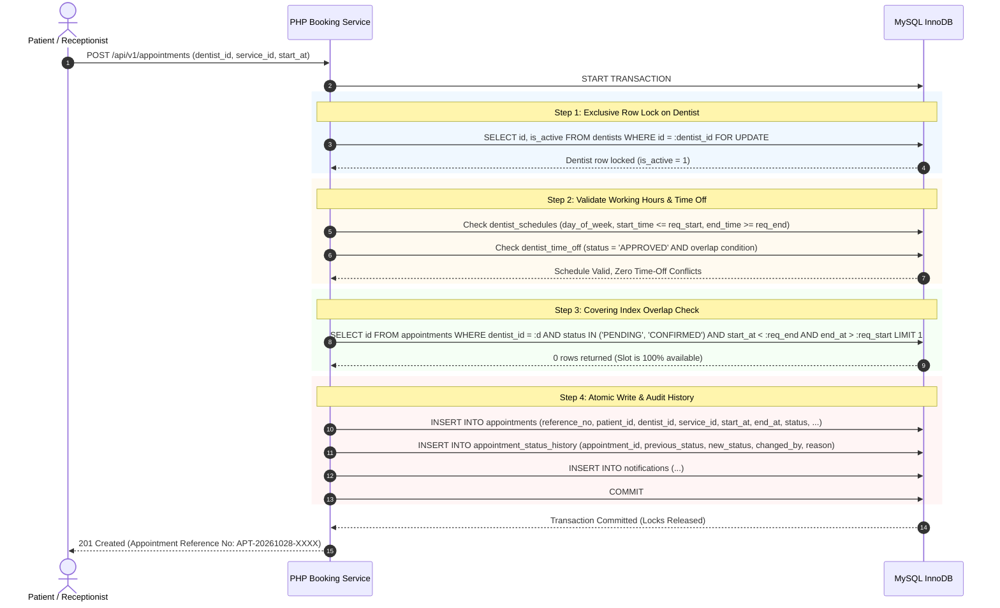

# ToothCare Hub — Appointment Overlap and Booking Concurrency Strategy
**Document Version:** 1.0.0  
**Phase:** Phase 4 — Database Modeling and Versioned Schema  
**Status:** Approved Architecture Specification  
**Database Engine:** MySQL 8.0 (InnoDB)  
**Transaction Isolation Level:** `READ COMMITTED` or `REPEATABLE READ` (Default: InnoDB `REPEATABLE READ`)  

---

## 1. Executive Summary

In a dental clinic appointment scheduling system, double-booking is a critical clinical and operational failure. Two patients must never be scheduled with the same dentist for overlapping time windows, nor should an appointment be confirmed during a dentist's approved time-off or outside working hours.

Because appointments span continuous time intervals (`[start_at, end_at)`), a standard SQL `UNIQUE (dentist_id, start_at)` index is **insufficient**: it only prevents appointments starting at the exact same minute, but completely fails to detect:
1. An appointment starting 15 minutes into an existing 60-minute procedure.
2. An appointment that fully encloses an existing shorter procedure.
3. Two procedures that partially overlap at the beginning or end.

Furthermore, concurrent booking requests submitted at the same microsecond by two patients or receptionists could both read the schedule as empty and both insert overlapping rows if relying solely on application-level read checks.

This document details ToothCare Hub's **pessimistic row-locking concurrency strategy** (`SELECT ... FOR UPDATE` on the parent dentist record) and the canonical interval overlap comparison formula enforced at the database interaction layer.

---

## 2. Core Booking Concurrency Protocol

### 2.1 The Dentist-Row Serialization Anchor

To prevent race conditions between two concurrent transactions attempting to book the same dentist, ToothCare Hub uses the parent row in the `dentists` table as an exclusive lock anchor:

```sql
SELECT id, is_active FROM dentists WHERE id = :dentist_id FOR UPDATE;
```

#### Why Lock the Dentist Row?
1. **Serialization Scope:** The lock serializes all booking, rescheduling, and status-modification writes for *that specific dentist* without blocking booking operations for other dentists in the clinic.
2. **Prevent Phantom Overlaps:** In MySQL InnoDB, row-level gap locks in `REPEATABLE READ` can lead to deadlocks if two transactions insert into adjacent gaps. By explicitly locking the single parent `dentists` row first, all concurrent transactions targeting that dentist queue up deterministically.
3. **Consistent Lock Order:** Deadlocks are mathematically prevented by strictly adhering to a global lock acquisition hierarchy:
   $$\text{Dentist Row Lock} \longrightarrow \text{Appointment Interval Evaluation} \longrightarrow \text{Appointment Insert / Update}$$

---

### 2.2 Canonical Overlap Formula

Two time intervals $[A_{\text{start}}, A_{\text{end}})$ and $[B_{\text{start}}, B_{\text{end}})$ overlap if and only if:

$$\text{existing.start\_at} < \text{requested.end\_at} \quad\land\quad \text{existing.end\_at} > \text{requested.start\_at}$$

#### Truth Table & Interval Scenarios

| Scenario | Existing `[09:00, 10:00)` vs Requested | Formula Evaluation | Overlap? |
| :--- | :--- | :--- | :--- |
| **Exact Match** | Requested: `[09:00, 10:00)` | `09:00 < 10:00 (T)` AND `10:00 > 09:00 (T)` | **TRUE (Conflict)** |
| **Partial Overlap (Start)** | Requested: `[08:30, 09:30)` | `09:00 < 09:30 (T)` AND `10:00 > 08:30 (T)` | **TRUE (Conflict)** |
| **Partial Overlap (End)** | Requested: `[09:30, 10:30)` | `09:00 < 10:30 (T)` AND `10:00 > 09:30 (T)` | **TRUE (Conflict)** |
| **Full Enclosure (Outer)** | Requested: `[08:00, 11:00)` | `09:00 < 11:00 (T)` AND `10:00 > 08:00 (T)` | **TRUE (Conflict)** |
| **Full Enclosure (Inner)** | Requested: `[09:15, 09:45)` | `09:00 < 09:45 (T)` AND `10:00 > 09:15 (T)` | **TRUE (Conflict)** |
| **Immediately Preceding (Adjacent)** | Requested: `[08:00, 09:00)` | `09:00 < 09:00 (F)` AND `10:00 > 08:00 (T)` | **FALSE (Valid Adjacent Slot)** |
| **Immediately Following (Adjacent)** | Requested: `[10:00, 11:00)` | `09:00 < 11:00 (T)` AND `10:00 > 10:00 (F)` | **FALSE (Valid Adjacent Slot)** |
| **Completely Disjoint Earlier** | Requested: `[07:00, 08:00)` | `09:00 < 08:00 (F)` AND `10:00 > 07:00 (T)` | **FALSE (Valid)** |
| **Completely Disjoint Later** | Requested: `[11:00, 12:00)` | `09:00 < 12:00 (T)` AND `10:00 > 11:00 (F)` | **FALSE (Valid)** |

> [!IMPORTANT]
> The strict inequalities (`<` and `>`) ensure that **adjacent appointments are permitted**. An appointment ending at `09:30:00` seamlessly allows another appointment to begin at `09:30:00` without triggering false conflict flags.

---

### 2.3 Status Blocking Policy (`DEC-POL-004`)

Not all appointments in the database occupy clinical chair time. The blocking status policy defines which records reserve a slot:

| Appointment Status | Blocks Time Slot? | Clinical & Business Rationale |
| :--- | :---: | :--- |
| `PENDING` | **YES** | A patient request awaiting receptionist approval reserves the chair to prevent double-booking while under clinical review. |
| `CONFIRMED` | **YES** | An active, confirmed appointment holds the slot. |
| `COMPLETED` | **YES** (Historical) | A finished appointment remains in the historical schedule. |
| `REJECTED` | **NO** | A rejected request is archived; the slot is immediately released for other patients. |
| `CANCELLED` | **NO** | A cancelled appointment immediately frees the schedule upon transaction commit. |

#### Time-Off Blocking
In addition to appointments, approved leave in `dentist_time_off` blocks scheduling:
```sql
SELECT COUNT(*) FROM dentist_time_off
WHERE dentist_id = :dentist_id
  AND status = 'APPROVED'
  AND start_at < :requested_end
  AND end_at > :requested_start;
```

---

## 3. End-to-End Booking Transaction Execution Flow

Every appointment creation follows this 10-step atomic workflow:



### Detailed Failure & Conflict Handling
- If **Dentist is inactive or not found**: API rolls back transaction (`ROLLBACK`) and returns `404 Not Found` or `422 Unprocessable Content`.
- If **Requested interval is outside working hours or in time-off**: API rolls back (`ROLLBACK`) and returns `422 Unprocessable Content` with message `"Selected time is outside dentist working schedule."`
- If **Overlap check returns $\ge 1$ existing blocking appointment**: API rolls back (`ROLLBACK`) and returns `409 Conflict`:
  ```json
  {
    "status": "error",
    "code": "SLOT_UNAVAILABLE",
    "message": "The selected appointment slot is no longer available. Please select another time.",
    "conflict_details": {
      "dentist_id": 1,
      "requested_start": "2026-10-28T09:00:00+08:00",
      "requested_end": "2026-10-28T09:45:00+08:00"
    }
  }
  ```

---

## 4. Rescheduling and Cancellation Concurrency

### 4.1 Rescheduling Protocol (`DEC-POL-008`)
Rescheduling is executed as an **atomic swap**:
1. `START TRANSACTION;`
2. Lock Dentist: `SELECT id FROM dentists WHERE id = :dentist_id FOR UPDATE;`
3. Lock Original Appointment: `SELECT id, status FROM appointments WHERE id = :original_id FOR UPDATE;`
4. Verify original appointment is `PENDING` or `CONFIRMED`.
5. Check overlap on target slot, **explicitly excluding the original appointment ID**:
   ```sql
   SELECT id FROM appointments
   WHERE dentist_id = :dentist_id
     AND id != :original_id
     AND status IN ('PENDING', 'CONFIRMED')
     AND start_at < :new_requested_end
     AND end_at > :new_requested_start
   LIMIT 1;
   ```
6. If target slot is free:
   - Cancel original appointment: `UPDATE appointments SET status = 'CANCELLED' WHERE id = :original_id;`
   - Create new appointment with `rescheduled_from_id = :original_id`.
   - Insert status history rows for both original and new appointments.
   - `COMMIT;`
7. If conflict exists: `ROLLBACK;` and return `409 Conflict`.

### 4.2 Cancellation Protocol
1. `START TRANSACTION;`
2. `SELECT id, status FROM appointments WHERE id = :id FOR UPDATE;`
3. Verify status transition (`CONFIRMED -> CANCELLED` or `PENDING -> CANCELLED`).
4. `UPDATE appointments SET status = 'CANCELLED', cancellation_reason = :reason WHERE id = :id;`
5. `INSERT INTO appointment_status_history (appointment_id, previous_status, new_status, changed_by, reason) VALUES (...);`
6. `COMMIT;`
7. **Effect:** The cancelled appointment row has `status = 'CANCELLED'`. In subsequent overlap queries, `status IN ('PENDING', 'CONFIRMED')` ignores this row, instantly making the time interval bookable for other patients.

---

## 5. Lock Order Matrix

To guarantee total freedom from distributed transaction deadlocks, all database operations touching appointments must acquire row locks in this exact order:

$$\text{dentists} \longrightarrow \text{appointments (parent / original)} \longrightarrow \text{appointments (child / new)}$$

| Operation | Locks Acquired (In Order) |
| :--- | :--- |
| **New Booking** | 1. `dentists (id = :dentist_id)` |
| **Reschedule Appointment** | 1. `dentists (id = :dentist_id)`<br>2. `appointments (id = :old_appointment_id)` |
| **Cancel Appointment** | 1. `appointments (id = :appointment_id)` |
| **Receptionist Approve / Reject** | 1. `appointments (id = :appointment_id)` |
| **Complete Visit & Treatment** | 1. `appointments (id = :appointment_id)`<br>2. `treatment_records (INSERT)` |

---

## 6. Covering Index Optimization for Overlap Checks

The MySQL database contains the following tailored covering index:
```sql
CREATE INDEX idx_appointments_overlap 
ON appointments (dentist_id, status, start_at, end_at);
```

### EXPLAIN Execution Evidence
When executing the overlap check:
```sql
EXPLAIN SELECT id FROM appointments
WHERE dentist_id = 1
  AND status IN ('PENDING', 'CONFIRMED')
  AND start_at < '2026-10-28 10:00:00'
  AND end_at > '2026-10-28 09:00:00'
LIMIT 1;
```

**Result from MySQL 8.0.46:**
- **type:** `range`
- **key:** `idx_appointments_overlap`
- **Extra:** `Using where; Using index`

Because all evaluated columns (`dentist_id`, `status`, `start_at`, `end_at`) and the clustered key (`id`) are stored directly in the B-Tree leaf pages of `idx_appointments_overlap`, MySQL answers the query entirely in memory without performing secondary data page lookups (`Using index`). This ensures maximum throughput during concurrent booking rushes.
