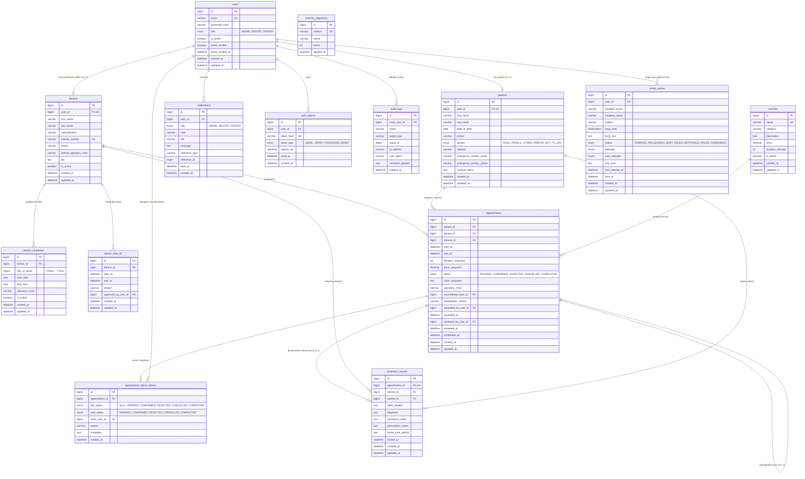

# ToothCare Hub — Entity-Relationship Diagram & Relationship Model

**Document ID:** `TCH-P4-ERD-001`  
**Version:** `1.0.0`  
**Phase:** Phase 4 — Database Modeling and Versioned Schema  
**Prepared Date:** `2026-10-27`  
**Status:** Approved Baseline  
**Author:** Lead Database Architect & Security Specialist  

---

## 1. Entity-Relationship Overview

The **ToothCare Hub** relational model is designed to support the complete clinic appointment lifecycle, role-based authorization boundaries, clinical documentation, and real-time asynchronous messaging.

---

## 2. Referential Integrity & Relationship Specifications

| Parent Entity | Child Entity | Foreign Key Column | Cardinality | Deletion Behavior (`ON DELETE`) | Update Behavior (`ON UPDATE`) | Business Rule & Justification |
| :--- | :--- | :--- | :---: | :--- | :--- | :--- |
| `users` | `patients` | `patients.user_id` | `1 : 0..1` | `RESTRICT` | `CASCADE` | User cannot be deleted if patient medical profile exists. Deactivation via `is_active=0` preferred. |
| `users` | `dentists` | `dentists.user_id` | `1 : 0..1` | `RESTRICT` | `CASCADE` | Dentist practitioner cannot be deleted if user account exists. Preserves clinical license audit. |
| `users` | `notifications` | `notifications.user_id` | `1 : 0..N` | `CASCADE` | `CASCADE` | Ephemeral notifications cascade if user is purged. |
| `users` | `auth_tokens` | `auth_tokens.user_id` | `1 : 0..N` | `CASCADE` | `CASCADE` | Security tokens are revoked/purged on user removal. |
| `users` | `audit_logs` | `audit_logs.actor_user_id`| `1 : 0..N` | `SET NULL` | `CASCADE` | Audit trails remain intact even if user account is permanently deleted (`actor_user_id` becomes NULL). |
| `dentists` | `dentist_schedules`| `dentist_schedules.dentist_id`| `1 : 0..N` | `CASCADE` | `CASCADE` | Working shifts belong exclusively to a practitioner. |
| `dentists` | `dentist_time_off` | `dentist_time_off.dentist_id` | `1 : 0..N` | `CASCADE` | `CASCADE` | Leave periods belong exclusively to a practitioner. |
| `patients` | `appointments` | `appointments.patient_id` | `1 : 0..N` | `RESTRICT` | `CASCADE` | Strict restriction: Patient records with appointment history can NEVER be silently deleted. |
| `dentists` | `appointments` | `appointments.dentist_id` | `1 : 0..N` | `RESTRICT` | `CASCADE` | Strict restriction: Dentist records with clinical bookings can NEVER be deleted. |
| `services` | `appointments` | `appointments.service_id` | `1 : 0..N` | `RESTRICT` | `CASCADE` | Services cannot be deleted if historical appointments reference them (deactivate via `is_active=0`). |
| `appointments` | `appointments` | `appointments.rescheduled_from_id` | `1 : 0..1` | `SET NULL` | `CASCADE` | Self-referencing link for atomic rescheduling chain (`DEC-POL-008`). |
| `appointments` | `appointment_status_history`| `appointment_status_history.appointment_id` | `1 : 1..N` | `RESTRICT` | `CASCADE` | Audit log of status transitions is strictly permanent. |
| `appointments` | `treatment_records`| `treatment_records.appointment_id` | `1 : 0..1` | `RESTRICT` | `CASCADE` | Clinical treatment records are permanent legal medical documentation. |
| `dentists` | `treatment_records`| `treatment_records.dentist_id` | `1 : 0..N` | `RESTRICT` | `CASCADE` | Clinical notes are irrevocably linked to authoring dentist. |
| `patients` | `treatment_records`| `treatment_records.patient_id` | `1 : 0..N` | `RESTRICT` | `CASCADE` | Clinical notes are irrevocably linked to subject patient. |
| `users` | `email_outbox` | `email_outbox.user_id` | `1 : 0..N` | `SET NULL` | `CASCADE` | Outbox delivery queue persists even if user is removed. |

---

## 3. Scope Boundary Alignment

- **One Service Per Appointment (MVP):** Modeled directly via `appointments.service_id` with `price_snapshot` and `duration_snapshot`. If future phases support multi-service bookings, an `appointment_services` junction table will be introduced without breaking single-service integrity.
- **Unified Role Modeling:** User roles are constrained to `ENUM('ADMIN', 'DENTIST', 'PATIENT')`. Receptionists and clinic administrators share the `ADMIN` role for the MVP per approved decision `DEC-P3-009`.
