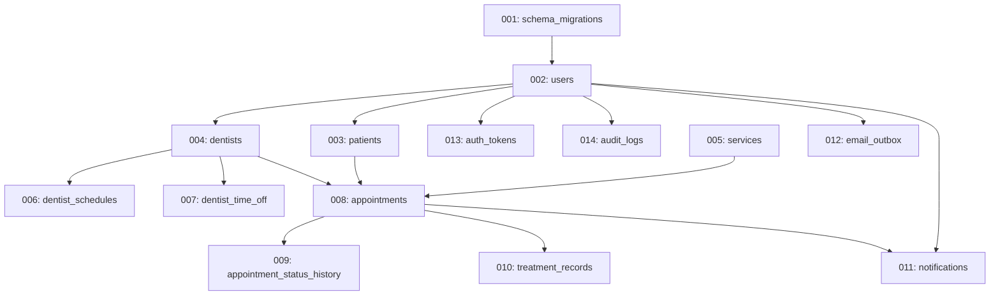

# ToothCare Hub — Phase 4 Implementation Plan
## Database Modeling and Versioned Schema

**Document ID:** `TCH-P4-PLN-001`  
**Version:** `1.0.0`  
**Phase:** Phase 4 — Database Modeling and Versioned Schema  
**Prepared Date:** `2026-10-27`  
**Status:** Approved Baseline  
**Author:** Lead Database Architect & Security Specialist  

---

## 1. Executive Summary & Objective

The objective of **Phase 4** is to create a fully normalized, high-performance, and verifiable relational database schema for **ToothCare Hub**. The database enforces the approved business policies (`TCH-P0-POL-001`), user journeys (`TCH-P3-UJM-001`), and role-based permissions (`TCH-P0-RBAC-001`) directly through MySQL 8.0 schema constraints, foreign keys, check constraints, composite indexes, and row-level concurrency locking strategies.

---

## 2. Technical Stack & Environment Baseline

- **RDBMS Engine:** MySQL 8.0 Community Server (Docker container: `toothcare-mysql`)
- **Storage Engine:** InnoDB exclusively for ACID transactions, row-level locking, and foreign key referential integrity
- **Character Set & Collation:** `utf8mb4` with `utf8mb4_unicode_ci` (full multilingual support and emoji support)
- **Timezone Anchor:** `Asia/Manila` (`UTC+08:00`, no DST)
- **Monetary Precision:** `DECIMAL(10,2)` for all fees and price snapshots (never floating-point `FLOAT`/`DOUBLE`)
- **Temporal Datatypes:** `DATETIME` for interval boundaries (`start_at`, `end_at`), `TIMESTAMP` for creation/update audits

---

## 3. Core & Support Entity Architecture

Conforming to the approved architecture, the schema implements 14 distinct tables:

1. **`schema_migrations`**: Migration ledger tracking applied versions, checksums, and execution timestamps.
2. **`users`**: Central authentication table (email, Argon2id hash, role `ADMIN`/`DENTIST`/`PATIENT`, active flag).
3. **`patients`**: 1:1 patient profile linked to `users`, demographics, contact details, medical alerts/allergies.
4. **`dentists`**: 1:1 dentist profile linked to `users`, PRC license number, dental specialty, assigned operatory chair.
5. **`services`**: Clinic service catalog, procedure category, standard duration minutes (30, 45, 60, 90), fee in PHP.
6. **`dentist_schedules`**: Recurring weekly working shifts (`day_of_week` 1..7, `start_time`, `end_time`, `chair`).
7. **`dentist_time_off`**: Vacation, leave, and emergency blocked interval exceptions (`start_at`, `end_at`).
8. **`appointments`**: Core scheduling entity (`patient_id`, `dentist_id`, `service_id`, `start_at`, `end_at`, `status`, price/duration snapshots, `rescheduled_from_id`).
9. **`appointment_status_history`**: Immutable status audit trail (`old_status`, `new_status`, `actor_user_id`, `reason`).
10. **`treatment_records`**: Clinical medical records (`teeth_treated`, `diagnosis`, `procedure_notes`, `prescription_notes`, 24h edit window).
11. **`notifications`**: Persistent in-app user notifications and read receipts.
12. **`email_outbox`**: Asynchronous transactional email job queue with exponential retry backoff.
13. **`auth_tokens`**: Purpose-limited single-use hashed tokens for email verification and password reset.
14. **`audit_logs`**: Security, authentication, and clinical modification audit logging.

---

## 4. Implementation Phasing & Dependency Sequence

---

## 5. Verification Strategy

1. **Empty Database Provisioning:** Run all 14 migrations on clean `toothcare_hub` database.
2. **Migration Idempotency:** Execute migration runner again; confirm zero reapplications or syntax errors.
3. **Foreign Key Integrity:** Attempt invalid foreign key inserts and confirm rejection (`1452 Cannot add or update a child row`).
4. **Unique Constraints:** Confirm duplicate email, license number, and token hash rejections.
5. **CHECK Constraints:** Validate invalid roles, invalid appointment statuses, negative fees, and inverted intervals (`end_at <= start_at`).
6. **Synthetic Seed Loading:** Populate realistic development dataset with Argon2id hashes, zero real patient data.
7. **Concurrency & Locking Drill:** Verify `SELECT ... FOR UPDATE` row-locking on `dentists` table and overlap detection query with `EXPLAIN` query plan analysis.
