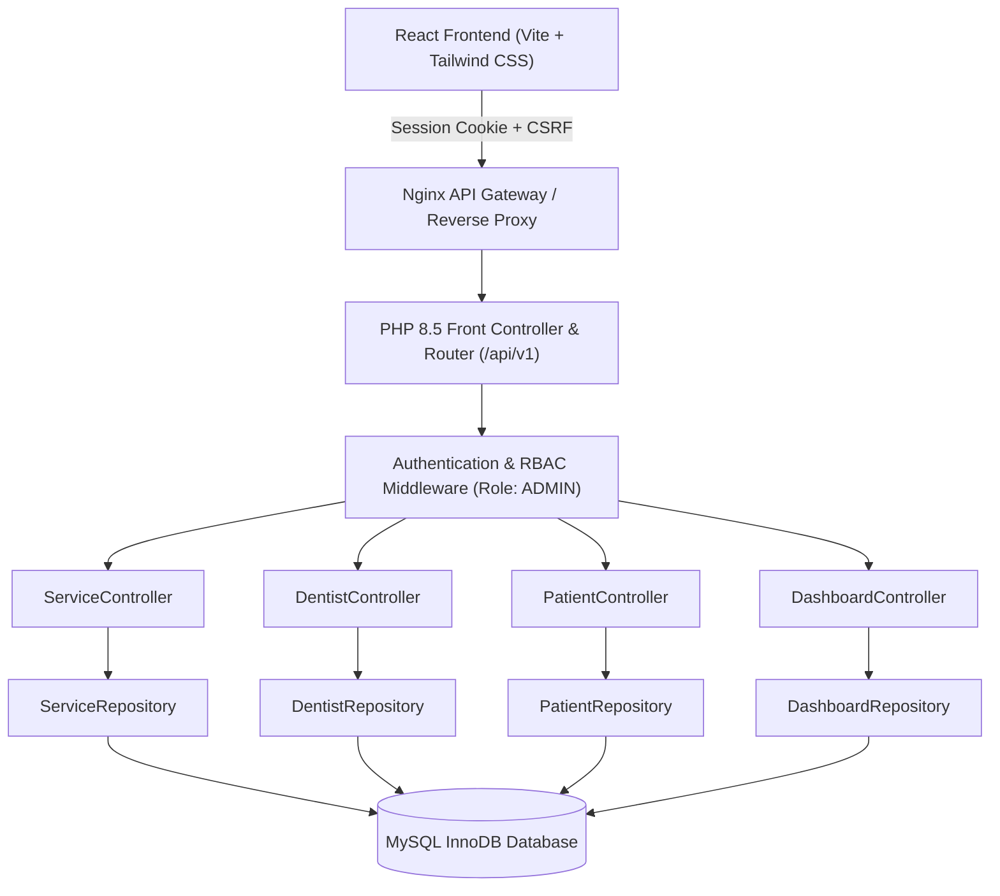

# Phase 8 — Administrative CRUD Modules & Clinic Operations
## ToothCare Hub — Dental Appointment and Clinic Management System

---

## 1. Executive Summary

Phase 8 introduces enterprise-grade administrative operations, clinic catalog configuration, practitioner roster management, patient registry oversight, and real-time operational dashboard metrics for ToothCare Hub.

Building upon the robust session-based identity foundation established in Phase 7, Phase 8 enforces strict server-side Role-Based Access Control (RBAC), SQL injection prevention via allowlisted sorting, relational data integrity constraints, and historical clinical record preservation.

---

## 2. Architectural Pillars

### Key Highlights:
1. **Server-Side Security**: Administrative endpoints under `/api/v1/admin/*` are strictly guarded by `AuthenticationMiddleware` and `AuthorizationMiddleware(['ADMIN'])`. Frontend UI checks are solely UX enhancements, not trust boundaries.
2. **Clinical Data Preservation**: Historical appointments, consultations, and treatment records are strictly protected. Clinic services and dentist profiles utilize soft deactivation (`is_active = 0`) rather than destructive `DELETE` operations.
3. **Real MySQL Dashboard Intelligence**: Zero artificial mock stats. The administrative dashboard queries real aggregated counts and activity streams directly from the database engine.
4. **Resilient Sorting & Pagination**: All `sort_by` fields are validated against strict compile-time column allowlists, thwarting SQL injection attacks on dynamic `ORDER BY` clauses.

---

## 3. Implemented Modules

| Module | Route Group | Description |
| :--- | :--- | :--- |
| **Services Management** | `/api/v1/admin/services`, `/api/v1/services` | Dental procedure catalog, duration snapshots (15/30/45/60/90/120 min), treatment fees, and booking visibility. |
| **Dentist Management** | `/api/v1/admin/dentists`, `/api/v1/dentists` | Licensed practitioner profiles, PRC license validation, default operatory chair assignment, and login status synchronization. |
| **Patient Registry** | `/api/v1/admin/patients`, `/api/v1/patients/{id}` | Demographic records, emergency contacts, clinical medical alerts, account status control, and past visit summaries. |
| **Executive Dashboard** | `/api/v1/admin/dashboard` | Real-time aggregate counts for patients, dentists, services, appointment status distribution, and today's schedule. |

---

## 4. Phase Documentation Directory

- [`ADMIN_API.md`](./ADMIN_API.md): Detailed REST API specification for administrative and public endpoints.
- [`CRUD_MODULES.md`](./CRUD_MODULES.md): Business rules, validation logic, and lifecycle behavior for Services, Dentists, and Patients.
- [`PAGINATION_SEARCH_FILTERS.md`](./PAGINATION_SEARCH_FILTERS.md): Mechanics of server-side pagination, wildcard searching, and sorting security.
- [`DASHBOARD.md`](./DASHBOARD.md): MySQL aggregate queries, performance indexing, and operational intelligence metrics.
- [`TESTING.md`](./TESTING.md): PHPUnit unit and integration test suite coverage report.
- [`IMPLEMENTATION_REPORT.md`](./IMPLEMENTATION_REPORT.md): Comprehensive implementation summary and Phase 9 handoff.

