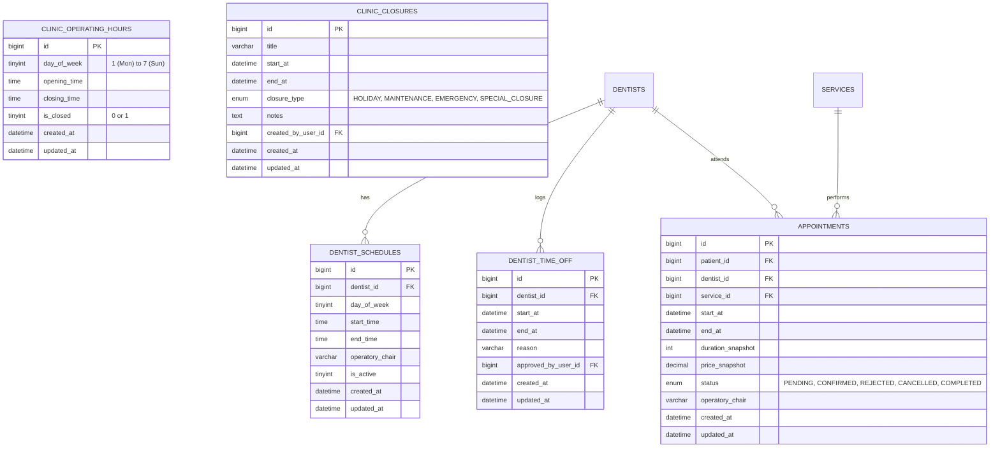

# Phase 9: Database Design & Schema Specifications
## ToothCare Hub — Dental Appointment and Clinic Management System

---

## 1. Schema Overview

Phase 9 completes the scheduling schema foundation by introducing migration `016_create_clinic_hours_and_closures.sql` alongside existing migrations `006_create_dentist_schedules.sql`, `007_create_dentist_time_off.sql`, and `008_create_appointments.sql`.

---

## 2. Table Specifications

### 2.1 `clinic_operating_hours`
Defines facility availability by weekday:
- `id`: BIGINT UNSIGNED AUTO_INCREMENT PRIMARY KEY
- `day_of_week`: TINYINT UNSIGNED NOT NULL (1 = Monday ... 7 = Sunday)
- `opening_time`: TIME NOT NULL DEFAULT '08:00:00'
- `closing_time`: TIME NOT NULL DEFAULT '17:00:00'
- `is_closed`: TINYINT(1) NOT NULL DEFAULT 0
- Constraints: `chk_operating_interval CHECK (is_closed = 1 OR opening_time < closing_time)`
- Seed values: Monday–Friday 08:00–17:00, Saturday 08:00–12:00, Sunday closed.

### 2.2 `clinic_closures`
Facility-wide closure windows:
- `id`: BIGINT UNSIGNED AUTO_INCREMENT PRIMARY KEY
- `title`: VARCHAR(150) NOT NULL
- `start_at`: DATETIME NOT NULL
- `end_at`: DATETIME NOT NULL
- `closure_type`: ENUM('HOLIDAY', 'MAINTENANCE', 'EMERGENCY', 'SPECIAL_CLOSURE') NOT NULL DEFAULT 'HOLIDAY'
- `notes`: TEXT NULL
- `created_by_user_id`: BIGINT UNSIGNED NULL (FK -> `users.id`)
- Index: `idx_clinic_closures_dates (start_at, end_at)`
- Constraint: `chk_closure_interval CHECK (start_at < end_at)`

### 2.3 `dentist_schedules`
Recurring weekly practitioner shifts:
- `id`: BIGINT UNSIGNED AUTO_INCREMENT PRIMARY KEY
- `dentist_id`: BIGINT UNSIGNED NOT NULL (FK -> `dentists.id` ON DELETE CASCADE)
- `day_of_week`: TINYINT UNSIGNED NOT NULL (1..7)
- `start_time`: TIME NOT NULL
- `end_time`: TIME NOT NULL
- `operatory_chair`: VARCHAR(50) NOT NULL DEFAULT 'Chair 1'
- `is_active`: TINYINT(1) NOT NULL DEFAULT 1
- Index: `idx_dentist_shifts (dentist_id, day_of_week, is_active)`
- Constraint: `chk_shift_interval CHECK (start_time < end_time)`

### 2.4 `dentist_time_off`
Practitioner approved leaves:
- `id`: BIGINT UNSIGNED AUTO_INCREMENT PRIMARY KEY
- `dentist_id`: BIGINT UNSIGNED NOT NULL (FK -> `dentists.id` ON DELETE CASCADE)
- `start_at`: DATETIME NOT NULL
- `end_at`: DATETIME NOT NULL
- `reason`: VARCHAR(255) NOT NULL
- `approved_by_user_id`: BIGINT UNSIGNED NULL (FK -> `users.id`)
- Index: `idx_time_off_dentist_interval (dentist_id, start_at, end_at)`
- Constraint: `chk_time_off_interval CHECK (start_at < end_at)`

### 2.5 `appointments`
Core booking entity (Migration 008):
- Statuses blocking availability: `'PENDING'`, `'CONFIRMED'`.
- Statuses not blocking: `'CANCELLED'`, `'REJECTED'`, past `'COMPLETED'`.
- Index: `idx_appointments_overlap (dentist_id, status, start_at, end_at)`

