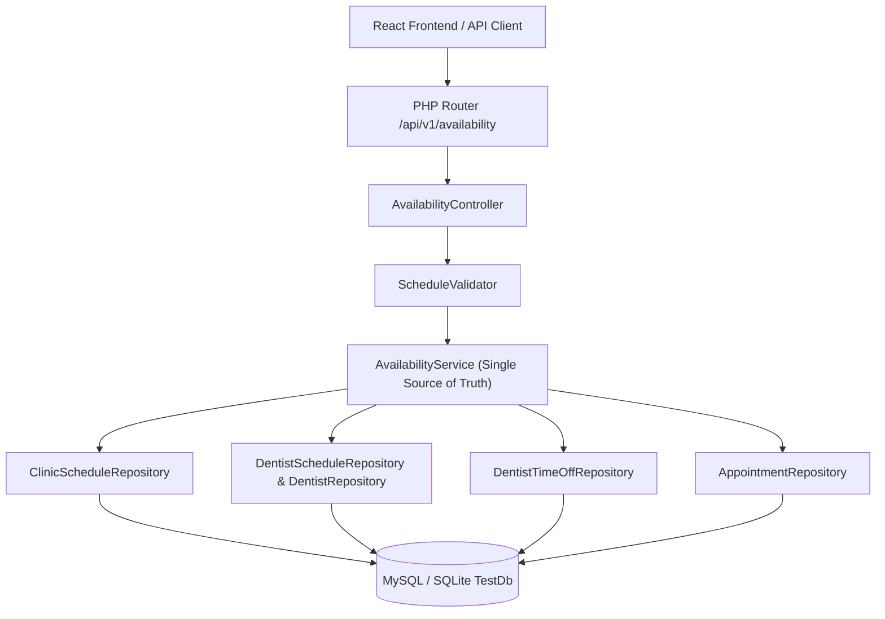

# Phase 9: Dentist Schedules and Availability Rules
## ToothCare Hub — Dental Appointment and Clinic Management System

---

## 1. Executive Summary

Phase 9 implements the core **Scheduling & Availability Engine** for ToothCare Hub. It establishes a centralized, deterministic, timezone-aware backend engine (`AvailabilityService`) that calculates bookable appointment slots while strictly enforcing:
- Clinic facility operating hours and day closures.
- Clinic-wide holidays, emergency closures, and maintenance windows.
- Recurring weekly practitioner shifts with operatory chair assignments.
- Approved practitioner leaves, vacations, and emergency absences.
- Procedure durations and post-treatment turnaround buffer intervals (default: 10 minutes).
- Active bookings (`PENDING`, `CONFIRMED`) via half-open interval overlap detection `[start, end)`.

---

## 2. Directory & Documentation Map

| Document | Description |
| :--- | :--- |
| [`SCHEDULING_RULES.md`](file:///c:/xampp/htdocs/GitHub_Clone_File_Projects/ToothCare-Hub/docs/phase-9/SCHEDULING_RULES.md) | Business logic precedence hierarchy, buffer policies, and conflict algorithms. |
| [`DATABASE_DESIGN.md`](file:///c:/xampp/htdocs/GitHub_Clone_File_Projects/ToothCare-Hub/docs/phase-9/DATABASE_DESIGN.md) | Schema definitions, migration 016, indexes, relationships, and constraints. |
| [`AVAILABILITY_ENGINE.md`](file:///c:/xampp/htdocs/GitHub_Clone_File_Projects/ToothCare-Hub/docs/phase-9/AVAILABILITY_ENGINE.md) | Technical architecture of `AvailabilityService`, slot generation, clamping, and query optimization. |
| [`TIMEZONE_POLICY.md`](file:///c:/xampp/htdocs/GitHub_Clone_File_Projects/ToothCare-Hub/docs/phase-9/TIMEZONE_POLICY.md) | Strict `Asia/Manila` (UTC+8) datetime standard across PHP, MySQL, and React. |
| [`ADMIN_SCHEDULE_MANAGEMENT.md`](file:///c:/xampp/htdocs/GitHub_Clone_File_Projects/ToothCare-Hub/docs/phase-9/ADMIN_SCHEDULE_MANAGEMENT.md) | Administrative guide for facility hours, shifts, closures, and time-off. |
| [`API_DOCUMENTATION.md`](file:///c:/xampp/htdocs/GitHub_Clone_File_Projects/ToothCare-Hub/docs/phase-9/API_DOCUMENTATION.md) | REST API contracts, request/response envelopes, and status codes. |
| [`TESTING.md`](file:///c:/xampp/htdocs/GitHub_Clone_File_Projects/ToothCare-Hub/docs/phase-9/TESTING.md) | 20 boundary conditions matrix, unit and integration test documentation. |
| [`IMPLEMENTATION_REPORT.md`](file:///c:/xampp/htdocs/GitHub_Clone_File_Projects/ToothCare-Hub/docs/phase-9/IMPLEMENTATION_REPORT.md) | Final milestone sign-off, quality metrics, and Phase 10 handoff. |

---

## 3. Architecture Overview

---

## 4. Verification Status

- **PHPUnit Tests**: 100/100 passing (740 assertions, 0 errors, 0 failures).
- **Frontend Build**: Vite production build succeeded in 10.64s with 0 errors.
- **OpenAPI 3.0.3**: Validated (36 paths, 14 schemas documented).

