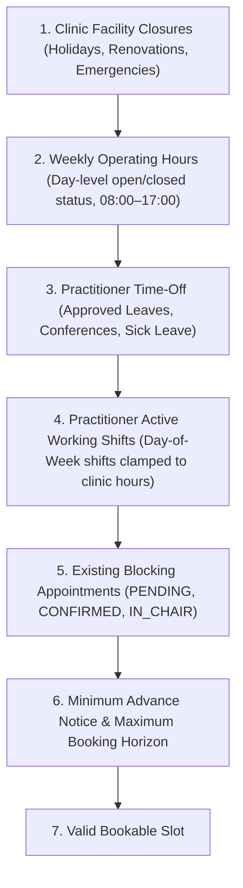

# Phase 9: Scheduling Rules & Precedence Hierarchy
## ToothCare Hub — Dental Appointment and Clinic Management System

---

## 1. Rule Precedence Hierarchy

The scheduling engine computes availability by evaluating constraints in strict descending order of authority:

### Hierarchy Breakdown:
1. **Clinic Facility Closures**: If a facility closure spans a given date-time window, all slots intersecting that interval are suppressed regardless of practitioner availability.
2. **Weekly Operating Hours**: If a day of the week is marked closed (`is_closed = 1`), no shifts or slots can exist on that day. If open, all shifts and slots must fit within `[opening_time, closing_time]`.
3. **Practitioner Time-Off**: Approved leave records suppress overlapping slots for that specific dentist.
4. **Practitioner Working Shifts**: Dentist recurring shifts define active working hours on that day of the week.
5. **Existing Bookings**: Appointments in `PENDING` or `CONFIRMED` statuses block slots. `CANCELLED`, `REJECTED`, or past `COMPLETED` appointments do not block slots.
6. **Advance Notice & Booking Horizon**:
   - Minimum advance notice: 120 minutes (2 hours from current time in `Asia/Manila`).
   - Maximum booking horizon: 90 days from current date.
   - Date range query limit: Maximum 14 days per request to prevent denial of service.

---

## 2. Half-Open Interval Arithmetic

All date-time intervals in ToothCare Hub follow the half-open interval convention:
$$\text{Interval} = [T_{\text{start}}, T_{\text{end}})$$

Under this convention:
- $T_{\text{start}}$ is **inclusive** (part of the appointment).
- $T_{\text{end}}$ is **exclusive** (the boundary point where the next slot or turn-around begins).

### Conflict Detection Formula
Two intervals $[A_{\text{start}}, A_{\text{end}})$ and $[B_{\text{start}}, B_{\text{end}})$ overlap if and only if:
$$A_{\text{start}} < B_{\text{end}} \quad \text{AND} \quad A_{\text{end}} > B_{\text{start}}$$

### Adjacency Property:
If Appointment A ends at `10:00:00` ($A_{\text{end}} = 10:00:00$), and Candidate Slot B starts at `10:00:00` ($B_{\text{start}} = 10:00:00$):
$$10:00:00 < 10:00:00 \quad (\text{FALSE})$$
Therefore, adjacent intervals do NOT conflict and are bookable without wasted dead time.

---

## 3. Buffer Policy

- Every dental procedure has a defined duration $D = \text{duration\_minutes}$.
- To allow operatory sanitization, instrument sterilization, and patient turnaround, a post-service buffer $B = \text{default\_buffer\_minutes}$ (10 minutes) is appended.
- The total blocking interval is:
$$\text{Blocking Window} = [T_{\text{start}}, T_{\text{start}} + D + B)$$
- **Schedule Fit Constraint**: The entire blocking window (procedure duration + turnaround buffer) must fit strictly within both the dentist's shift and the clinic's operating closing time:
$$T_{\text{start}} + D + B \le \min(T_{\text{shift\_end}}, T_{\text{clinic\_closing}})$$
A slot where the service ends at shift closing but the buffer extends beyond is rejected.

